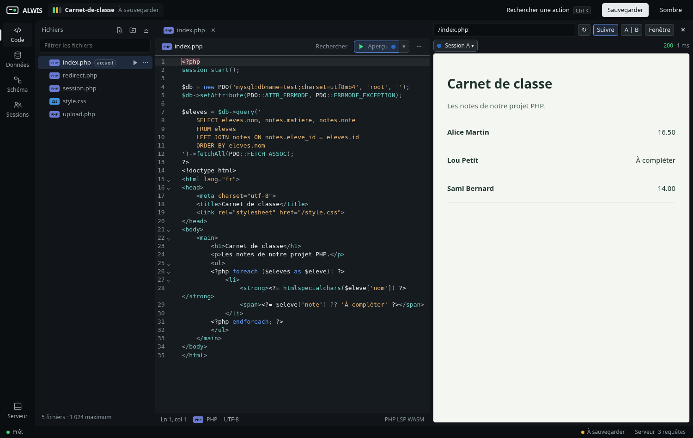
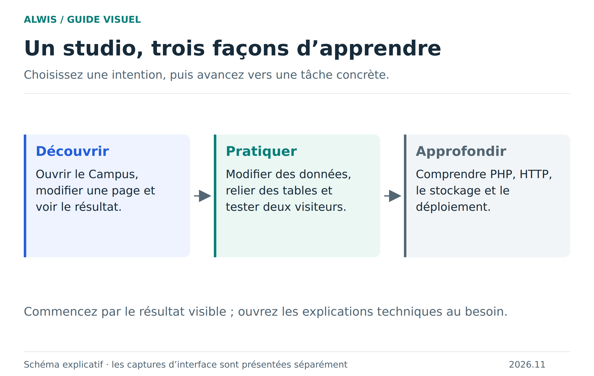

# ALWIS

### Votre atelier PHP & MariaDB. Dans un onglet.

Du code à la page web, des tables aux relations : construisez et explorez une application sans installer de serveur PHP ou SQL sur votre ordinateur.

**[Ouvrir ALWIS](https://studio.mmi.place/) · [Découvrir le wiki](https://github.com/Bastian-Noel/ALWIS/wiki) · [Télécharger](https://github.com/Bastian-Noel/ALWIS/releases)**

## Ouvrez un projet. Voyez-le vivre.

Choisissez l’exemple **Campus** pour découvrir une application déjà construite : élèves, cours, présences, notes, messages et documents. Modifiez une page, relancez l’aperçu et observez le résultat. Vous pouvez aussi créer votre projet ou importer une archive ZIP.

[Votre première visite guidée →](docs/README.md)

## Le code et son résultat, au même endroit

Éditeur avec coloration, complétion, recherche et outils de formatage ; arborescence du projet ; aperçu de votre site avec navigation et requêtes HTTP. PHP s’exécute réellement en WebAssembly dans le navigateur. MariaDB démarre au premier besoin SQL.

[Explorer l’éditeur](docs/ide-workflows.md) · [Comprendre le fonctionnement](docs/concepts.md)

## Les données deviennent visibles

Ouvrez une table, examinez ses lignes, exécutez une requête ou modifiez sa structure. Les vues **Données**, **Structure** et **Schéma** vous aident à passer du résultat visible au modèle qui l’explique.

Une valeur SQL mérite mieux qu’une case dans un tableau. Le wiki explique pourquoi `NULL`, un texte vide et zéro ont des sens différents, comment conserver les grands entiers et pourquoi un montant décimal doit garder sa précision.

[Prendre en main SQL](docs/sql-workflows.md) · [Comprendre les valeurs et leurs types](docs/sql-values.md)

## Reliez les tables. Comprenez votre application.

La vue Schéma rend les relations visibles. Dans le Campus, un élève est lié à un utilisateur et à une classe ; une inscription associe un élève à un cours. Les guides vous montrent comment lire ces liens et choisir une clé adaptée.

[Clés et relations, avec exemples →](docs/sql-relations.md)

## Plusieurs visiteurs, une même application

Testez des profils distincts avec les sessions de l’aperçu : chacun garde ses cookies et sa session PHP, tandis que les données SQL du projet restent communes. Le Campus fournit des profils fictifs pour observer ce comportement sans créer de comptes réels.

L’édition serveur permet aussi de partager une session de travail. Les invités peuvent utiliser un aperçu HTTP interactif exécuté par le navigateur hôte. Ce mode demande une configuration serveur et une origine d’aperçu HTTPS dédiée ; le lien du studio statique ne suffit pas à le mettre en place.

[Découvrir le Campus](docs/school-example.md) · [Partager et collaborer](docs/collaboration.md)

## Gardez votre travail. Emportez votre projet.

**Enregistrer** conserve un point de reprise dans le navigateur. **Exporter ZIP** produit une copie transportable des fichiers et des bases. Le wiki explique ces deux gestes, la différence avec un dossier du PC et ce qu’un export n’emporte pas, notamment les sessions privées des visiteurs.

[Bien sauvegarder un projet →](docs/saving-projects.md)

## Choisissez votre point de départ

| Votre objectif | Le chemin le plus direct |
|---|---|
| Essayer immédiatement | [Ouvrir le studio](https://studio.mmi.place/), puis choisir le Campus |
| Travailler localement | Télécharger le ZIP de la [version publiée](https://github.com/Bastian-Noel/ALWIS/releases/tag/v2026.11.0-beta.3), lancer `node serve.mjs`, ouvrir `http://127.0.0.1:8080` |
| Héberger votre instance | [Installer l’édition Docker](docs/server-deployment.md), disponible pour AMD64 et ARM64 |
| Développer ALWIS | [Contribuer](CONTRIBUTING.md) et [comprendre l’architecture](docs/architecture.md) |

**Découvrir :** [les concepts](docs/concepts.md) → [premiers pas](docs/README.md) → [Campus](docs/school-example.md).

**Pratiquer :** [code](docs/ide-workflows.md) → [SQL](docs/sql-workflows.md) → [relations](docs/sql-relations.md) → [transactions](docs/sql-transactions.md).

**Approfondir :** [HTTP](docs/http-runtime.md) → [stockage](docs/storage-opfs.md) → [architecture](docs/architecture.md) → [compilation WASM](docs/native-qa-build.md).

## Une bêta documentée et vérifiable

ALWIS 2026.11 Beta 3 utilise PHP 8.4.27 et MariaDB dans un runtime WASM reconstruit depuis les sources. Les validations couvrent Chromium et Firefox, PHP/SQL, les requêtes HTTP, la récupération après erreur et les invités HTTP. Consultez les [preuves et limites de validation](docs/runtime-parity.md), la [compatibilité](docs/compatibility.md) et le [dépannage](docs/troubleshooting.md).

La publication bêta conserve une **exception de licence explicitement documentée sur deux fichiers historiques de formatage PHP**. Cette décision du mainteneur ne constitue pas une autorisation des tiers ni une conformité GPL intégrale établie. Le code original ALWIS est sous GPL-2.0-only, avec une exception MIT pour son éditeur ; les composants tiers gardent leurs licences et la documentation ses conditions propres. [Licences](LICENSE.md) · [Composants tiers](THIRD-PARTY-NOTICES.md) · [État détaillé de la publication](provenance/release-licensing-status.json).

Les captures montrent le studio publié ; les planches sont des schémas pédagogiques. [Sources et méthode des illustrations](docs/illustrations.md).

[Signaler un problème](https://github.com/Bastian-Noel/ALWIS/issues) · [Historique des versions](https://github.com/Bastian-Noel/ALWIS/releases)
