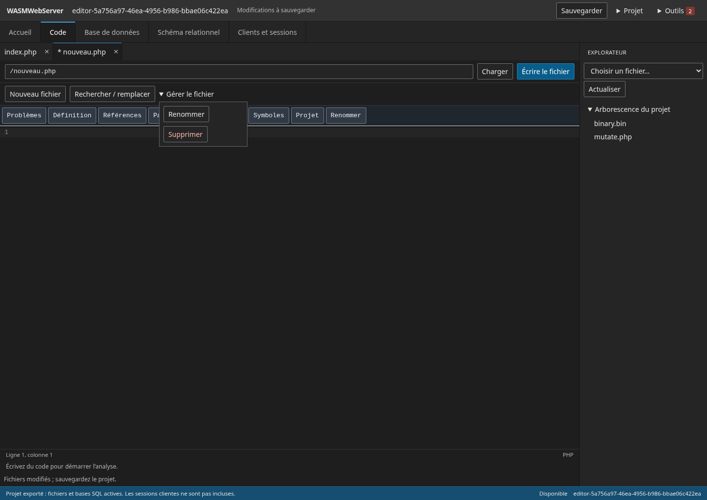

# WASMWebServer

[](https://github.com/Bastian-Noel/WASMWebServer/actions/workflows/check.yml)
[](https://github.com/Bastian-Noel/WASMWebServer/releases)

Un environnement local PHP + MariaDB dans votre navigateur : code, fichiers, SQL et fenêtres clientes avec sessions indépendantes ou partagées.



> [!IMPORTANT]
> Le studio reste un prototype. Les versions publiées et `main` peuvent avoir des fonctionnalités et validations différentes.

## Essayer depuis un ZIP

Téléchargez le ZIP applicatif de la [préversion IDE v0.2.0-preview.2](https://github.com/Bastian-Noel/WASMWebServer/releases/tag/v0.2.0-preview.2), extrayez-le puis lancez :

```sh
node serve.mjs
```

Ouvrez http://127.0.0.1:8080. Node 20+ sert les fichiers ; PHP et MariaDB tournent dans le navigateur. La [version stable précédente v0.1.0](https://github.com/Bastian-Noel/WASMWebServer/releases/tag/v0.1.0) reste disponible. Les améliorations de confort d’édition sur `main` sont postérieures à ces distributions.

## Outils disponibles

| Outil | Usage |
|---|---|
| Projets | Création, sauvegarde locale, import/export ZIP fichiers et SQL |
| Code | CodeMirror 6, coloration multilangage, services PHP/JS, types jQuery internes |
| SQL | Bases et tables, requêtes, grille paginée, structure, import/export |
| Schéma | Relations visuelles, clés étrangères, déplacement des tables |
| Clients | Plusieurs fenêtres et sessions indépendantes ou partagées |
| Ressources et journal | État des outils, déchargement et erreurs |

PHP 8.4.27 et MariaDB partagent un WASM avec pont natif PDO/MySQLi. Les 106 entrées MySQLi enregistrées comprennent six refus explicites ; cela ne garantit pas une compatibilité exhaustive. Chromium et Firefox sont testés. HTTPS et les en-têtes COOP/COEP sont nécessaires en production. Les projets restent dans le stockage du navigateur : exportez-les régulièrement.

## Documentation

[Guide utilisateur](docs/README.md) · [Architecture](docs/architecture.md) · [Compatibilité](docs/compatibility.md) · [Performance](docs/performance.md) · [Publication](docs/deployment.md) · [Contribuer](CONTRIBUTING.md)

Le moteur technique et l’archive `sources-2026-10-31` sont des distributions de restauration, distinctes du studio. Les sources épinglées, empreintes et notices restent dans `provenance/`. Les notes des releases conservent l’historique ; les reçus du dépôt sont des preuves liées à leurs révisions.

Les licences tierces sont préservées et regroupées dans `THIRD-PARTY.txt` du paquet. Aucune licence globale n’a été choisie pour le projet ; voir les notices avant redistribution.
