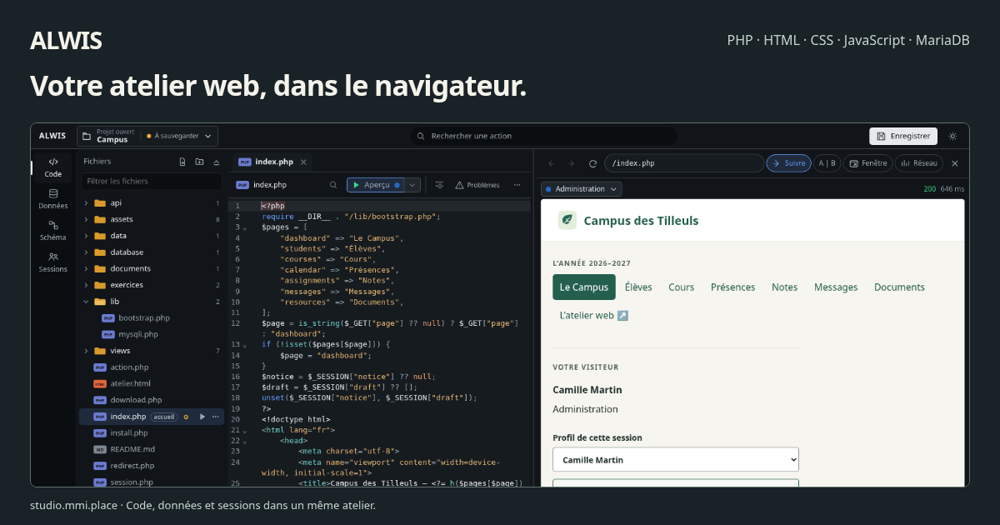
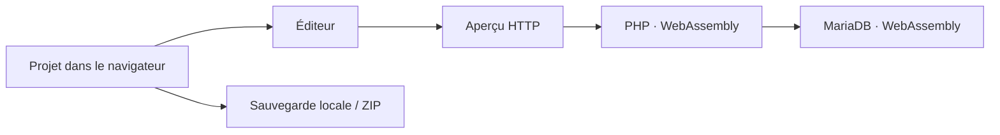

<div align="center">

# ALWIS

**Un environnement PHP et MariaDB directement dans votre navigateur.**

Écrivez du code, consultez vos données et ouvrez un vrai aperçu HTTP, sans installer de serveur PHP ou SQL sur votre ordinateur.

[](https://github.com/Bastian-Noel/ALWIS/actions/workflows/check.yml)
[](docs/versioning.md)
[](https://github.com/Bastian-Noel/ALWIS/wiki)

**[Installation](https://github.com/Bastian-Noel/ALWIS/wiki/Installation)** · **[Premiers pas](https://github.com/Bastian-Noel/ALWIS/wiki/Premiers-pas)** · **[Documentation](https://github.com/Bastian-Noel/ALWIS/wiki)** · **[Suivi du développement](https://github.com/Bastian-Noel/ALWIS/issues/1)**

</div>



## Développer sans installer de serveur

| **Code et aperçu** | **SQL et relations** | **Plusieurs visiteurs** |
| :--- | :--- | :--- |
| PHP, HTML, CSS et JavaScript avec coloration, complétion et formatage. | MariaDB, PDO, MySQLi, tables et schéma relationnel dans le navigateur. | Sessions isolées par cookies, un projet et une base partagés. |
|  |  |  |

Les projets sont stockés **localement dans votre navigateur**. Utilisez **Exporter ZIP** pour en conserver une copie indépendante.

## Essayer ALWIS

1. Récupérez une version disponible dans les [releases GitHub](https://github.com/Bastian-Noel/ALWIS/releases).
2. Décompressez l'archive, puis lancez dans ce dossier :

   ```bash
   node serve.mjs
   ```

3. Ouvrez **http://127.0.0.1:8080** et choisissez « Exemple scolaire » pour découvrir l'éditeur.

> [!NOTE]
> Il faut Node.js 20 ou une version supérieure pour servir localement l'application. PHP et MariaDB sont exécutés en WebAssembly par le navigateur : aucune installation PHP/MySQL n'est nécessaire.
>
> Les **nouvelles distributions sont suspendues** jusqu'à la validation des sources et licences du runtime natif. Les anciennes releases restent des références fonctionnelles, sans garantie de conformité de redistribution. La CI peut utiliser ces anciennes versions comme **témoins vérifiés par SHA-256**, sans valider la reconstruction GPLv2.

[Consulter le guide d'installation et l'édition Docker](https://github.com/Bastian-Noel/ALWIS/wiki/Installation)

## Ce qui est disponible

| Travail | Où aller |
| --- | --- |
| Créer ou importer un projet | **Accueil** : projet vide, exemple ou import ZIP |
| Modifier une page et voir le rendu | **Code → Aperçu** |
| Parcourir des tables et lancer du SQL | **Données** |
| Visualiser clés et relations | **Schéma** |
| Tester plusieurs identités utilisateur | **Sessions** |
| Comprendre les requêtes et erreurs | **Serveur** |
| Sauvegarder les fichiers | **Enregistrer**, puis **Exporter ZIP** |

**Collaboration :** l'édition serveur permet déjà l'échange de code et l'accès distant à certaines opérations fichiers/SQL. Le véritable aperçu HTTP par invité — exécuté chez l'hôte, sans miroir du DOM — est en cours de développement. [Fonctionnement et limites](docs/collaboration.md).

## Architecture en bref



Aucune base MariaDB n'est hébergée par le serveur ALWIS. Pour le partage collaboratif, **le navigateur hôte conserve le projet et exécute PHP et SQL**.

[Architecture](docs/architecture.md) · [Stockage](docs/storage-opfs.md) · [Compatibilité](docs/compatibility.md) · [Déploiement](docs/server-deployment.md)

## Version 1 · Beta

Le développement suit désormais les identifiants **`YYYY.MM.PATCH-beta.N`**. Exemple : `v2026.11.0-beta.1`, affiché **2026.11 · Beta 1**.

La [roadmap V1](https://github.com/Bastian-Noel/ALWIS/issues/1) couvre la parité du runtime GPLv2, le nouvel aperçu invité et les tests navigateur. Les publications officielles et les images Docker sont soumises à des vérifications de fonctionnalité, de sécurité et de licences.

[Convention de versionnement](docs/versioning.md) · [Contribuer](CONTRIBUTING.md) · [Proposer une amélioration](https://github.com/Bastian-Noel/ALWIS/issues/new/choose)

<details>
<summary><strong>Licences, attributions et sources natives</strong></summary>

Le code logiciel original ALWIS détenu par Bastian Noël est proposé sous **GPL-2.0-only**, avec utilisation commerciale autorisée ; ses adaptateurs d’éditeur originaux sont sous **MIT**. La documentation originale reste sous **CC BY-NC-SA**. Les composants tiers conservent leurs licences et notices ; voir `LICENSE.md`. La redistribution du runtime exige encore les preuves et sources correspondantes indiquées dans le statut de publication.

L'attribution obligatoire figure dans [NOTICE.md](NOTICE.md). Consultez [LICENSE.md](LICENSE.md), les [notices tierces](THIRD-PARTY-NOTICES.md), la [cartographie par composant](provenance/component-license-map.md) et le [statut de distribution](provenance/release-licensing-status.json) pour les limites et obligations actuelles.

</details>
