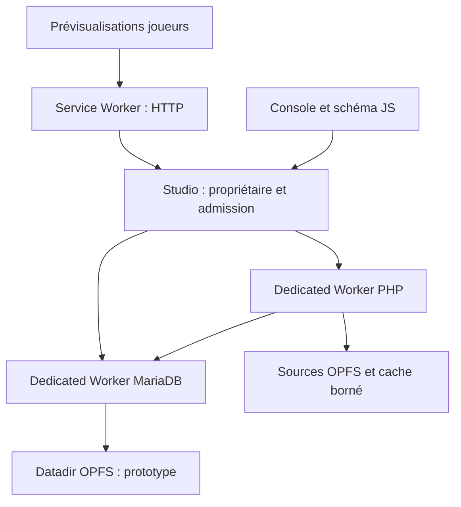

# Architecture cible

> Cadrage actualisé : voir [l’objectif actif](EXECUTION.md). N fenêtres avec sessions indépendantes ou partagées ; WASM unique PHP/MariaDB comme cible principale ; SQL à la demande et déchargement évalué sur mesures. Les scénarios à deux joueurs ci-dessous sont des tests, pas une limite produit.

## Propriétaire des moteurs et parcours HTTP

Le studio détient le verrou exclusif du projet (`navigator.locks`) et démarre les Dedicated Workers PHP et MariaDB. Les fenêtres de prévisualisation et de gestion ne démarrent aucun autre moteur pour ce projet.

Le Service Worker peut être arrêté par le navigateur : il ne possède pas la base et ne contient pas l'état durable du registre. À son redémarrage, il redécouvre le studio. Si le studio est fermé, il renvoie une erreur HTTP explicite et bornée dans le temps ; il ne recrée pas silencieusement une seconde base. Un second studio qui échoue à prendre le verrou reste client du premier.

Le studio restant ouvert ne garantit pas une exécution en arrière-plan illimitée : suspension d'onglet, veille et arrêt du navigateur doivent rester des cas de reprise.

## Identifiants et isolation

| Identifiant | Portée |
|---|---|
| `projectId` | Sources et données persistantes |
| `runtimeId` + génération | Propriétaire actif et redémarrage du moteur |
| `sessionId` | Joueur et cookie jar virtuel |
| `requestId` | Corrélation d'une requête/réponse |
| `ownerId` | Connexions et curseurs d'une requête PHP ou console |

Route proposée : `/run/<projectId>/<sessionId>/index.php`. Les URL absolues, redirections, chemins de formulaires et `fetch()` doivent conserver le contexte. Le runtime voit un document root cohérent sans préfixe artificiel dans ses chemins PHP.

Les cookies HTTP du site sont normalement communs aux onglets. Le coordinateur conserve donc un cookie jar **virtuel par session**, consomme les `Set-Cookie` de PHP et construit l'en-tête `Cookie` de la requête suivante. Les valeurs HttpOnly ne passent pas à l'application JS. Les scripts applicatifs qui lisent `document.cookie` ou utilisent des URL absolues devront faire partie des tests de compatibilité ; ne pas annoncer une isolation transparente avant ce test.

## Bus et admission

Reprendre les concepts de scopes de Playground, les gestionnaires CGI et le bus de Sean Morris. Choisir ce bus **ou** Comlink pour une frontière donnée. `BroadcastChannel` sert à découvrir le propriétaire et publier des invalidations ; `MessageChannel` sert aux échanges corrélés. Les messages comportent version, génération, identifiants et limites de taille. Nettoyer les ports et les callbacks à la fin ou à l'expiration.

La file JavaScript existante accepte une seule tâche active, au plus 32 en attente et 8 Mio d'octets déclarés actifs+en attente par défaut. Le caller doit déclarer les octets effectivement retenus et borner les métadonnées ; la classe ne mesure pas les closures JS. Un refus de surcharge doit devenir une réponse 503 avec stratégie de reprise côté client. Une annulation de fetch n'autorise pas à exécuter un second PHP avant que le premier ait effectivement fini.

## SQL natif commun

PDO adapté, MySQLi adapté et API JS console convergent vers le même contrat de backend. `packages/sql-native/include/pbl_sql.h` décrit les opérations et durées de vie proposées, sans implémentation ni ABI binaire stable.

| Opération | Exigence |
|---|---|
| Connexion | Session MariaDB réelle, base et charset explicites |
| Paramètres | NULL et binaire explicites ; pas de conversion BIGINT/DECIMAL en JS Number |
| Préparation | Implémenter de vraies préparations si API embarquée disponible ; sinon annoncer le mode émulé |
| Résultats | Métadonnées, lignes et erreurs ; buffers bornés avec curseur |
| Transactions | begin/commit/rollback par connexion, état conservé pendant la requête |
| Nettoyage | Fermer seulement les ressources du propriétaire terminé |
| Persistance | Barrière explicite après checkpoint et flush du VFS |

Le backend séparé ne partage pas des pointeurs C entre modules. Il envoie des frames avec longueurs, offsets, tags de types, identifiants/générations et octets transférables. Dans le build fusionné, l'adaptateur peut appeler directement l'API C et éviter la sérialisation. Les buffers alloués par un module sont libérés par ce module.

MySQLi dépend de mysqlnd dans PHP moderne. Deux spikes C sont à comparer : interposer les méthodes connexion/résultats/statement de mysqlnd, ou adapter les points d'entrée de l'extension MySQLi au cœur commun. Le remplacement du seul transport socket n'est pas suffisant pour parler à l'API embarquée. Aucun protocole MySQL TCP n'est nécessaire pour l'objectif local.

`mysqli_store_result`, `fetch_all`, `data_seek` et PDO bufferisé impliquent potentiellement de garder tout un résultat. Une API par lots ne garantit donc pas à elle seule une RAM constante : définir un plafond, ou un spool OPFS avec index de positions si ces comportements sont promis. Ne pas modifier silencieusement leur sémantique.

## Fichiers

| Emplacement logique | Propriétaire | Cible |
|---|---|---|
| Sources PHP/HTML/CSS/JS | Worker fichiers/PHP | OPFS, cache de 4 Mio pour fichiers actifs |
| Médias | Worker fichiers | Lecture par blocs/flux, sans préchargement global |
| Sessions PHP | Runtime PHP | Répertoire réservé du projet, pas celui des sources publiques |
| Datadir MariaDB | Worker DB uniquement | Backend OPFS natif à valider |
| Métadonnées UI | Studio | IndexedDB ou petit fichier séparé |
| JS/WASM immuables | Navigateur | Cache HTTP/Cache Storage versionné |

Un cache ne constitue pas le système de fichiers. Les `stat`, `open`, `read`, `write`, `seek`, `rename`, `unlink`, `truncate` et `fsync` de PHP/MariaDB exigent une adaptation réelle. Les sync access handles OPFS restent en Dedicated Worker. Les handles et métadonnées doivent eux aussi être bornés.

## Console et schéma relationnel

Interface JavaScript à charger à la demande : SQL, grille paginée, schéma. Les positions des tables sont des métadonnées UI ; les tables/colonnes/relations viennent de `information_schema` et `SHOW CREATE TABLE`.

Geste structurel → SQL proposé → exécution sur la connexion console → réintrospection → notification des fenêtres. Le DDL MariaDB peut provoquer un commit implicite ; annuler un déplacement visuel et annuler un ALTER TABLE ne sont pas la même opération. Les modifications de données utilisent la clé primaire, y compris composite, et une détection de conflit.

## Variantes à comparer

La référence séparée est prioritaire pour vérifier la compatibilité. Deux modules dans le même Worker peuvent réduire les messages, mais conservent deux mémoires et leurs copies. La variante fusionnée requiert une chaîne Emscripten commune, des réglages pthread/Asyncify/JSPI compatibles et une convention d'allocateurs claire. Elle sera conservée si le coût total mesuré, y compris reprise sur erreur et RAM, le justifie.

Le système de dossiers PC reste hors V1. Le multijoueur entre appareils nécessitera un transport vers l'hôte (par exemple WebRTC, signalisation et parfois TURN), sans réplication implicite d'IndexedDB.
