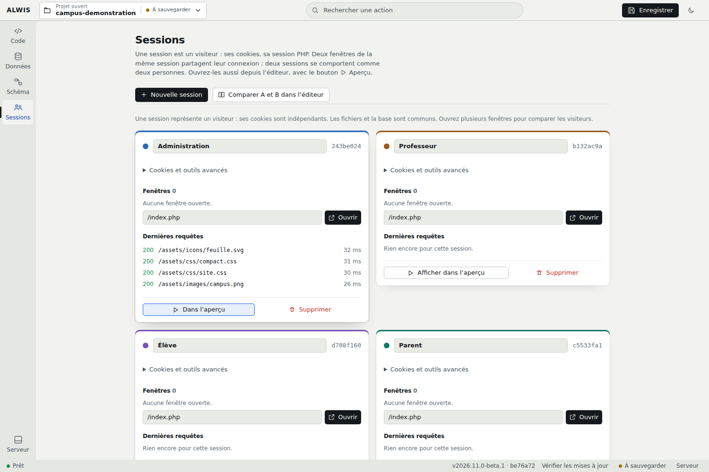
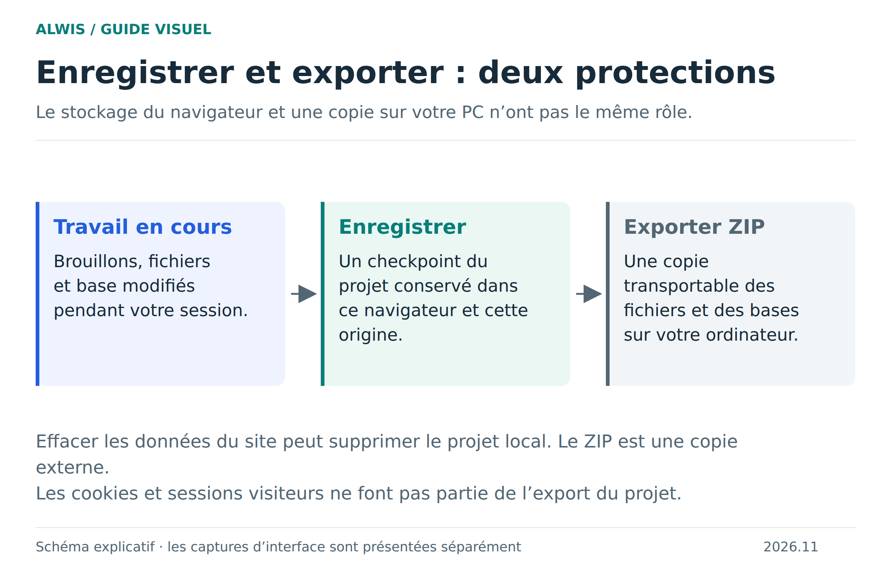

# Vos premiers pas avec ALWIS

L’objectif de cette visite est de modifier une application et de retrouver votre travail après fermeture. Commencez par le [studio en ligne](https://studio.mmi.place/) ; aucune installation PHP ou MariaDB n’est nécessaire.

## 1. Ouvrir le Campus

Depuis l’accueil, choisissez l’exemple Campus. Il contient du PHP, des ressources web et une base SQL. Les données sont fictives : vous pouvez expérimenter sur votre copie du projet.

## 2. Lire le code et voir son résultat

Dans **Code**, ouvrez `index.php`, puis son aperçu. L’arborescence contient notamment les vues, les ressources et le code de traitement. Modifiez un texte visible dans une vue, puis actualisez l’aperçu pour constater le changement. Une modification enregistrée dans l’éditeur n’est pas encore une archive indépendante de votre projet.

L’aperçu possède sa propre navigation. Sa barre d’adresse correspond à votre projet, pas à une URL de fichier sur le PC. Les formulaires exécutent du PHP dans le runtime du navigateur.

## 3. Ouvrir les données

Passez dans **Données**, choisissez la base du Campus puis la table `students`. Vous voyez des identifiants : ils représentent des liens, pas directement des noms de personnes. La table `users` contient les noms ; `classes` décrit les classes.

Avant une modification, lisez l’onglet **Structure** : le type de colonne et les contraintes déterminent les valeurs acceptées. Pour obtenir les noms avec leurs classes, suivez la [première requête avec jointure](sql-workflows.md).

## 4. Comprendre les liens

Dans **Schéma**, repérez le lien de `students.class_id` vers `classes.id`. Il signifie qu’un élève référence une classe existante. Déplacer un bloc dans le dessin sert à lire le modèle ; cela ne réaffecte pas un élève à une autre classe.

## 5. Tester deux visiteurs

Ouvrez **Sessions** et utilisez des visiteurs distincts. Changez le profil de l’un dans le Campus, puis consultez l’autre. Les profils de démonstration sont sans mot de passe. Leurs sessions PHP diffèrent, alors que les données SQL du projet restent communes.

Une session locale d’aperçu et un invité distant sont deux usages différents. Le [guide de collaboration](collaboration.md) explique la configuration nécessaire pour accueillir un autre navigateur.

## 6. Enregistrer et emporter

Cliquez sur **Enregistrer**, attendez la fin de l’opération, puis exportez un ZIP depuis les actions du projet. Conservez ce fichier hors du stockage du site. Pour vérifier votre sauvegarde, réimportez l’archive dans un autre projet et contrôlez un fichier ainsi qu’une valeur SQL que vous avez changés.

## Continuer selon votre objectif

| Vous voulez… | Poursuivre avec… |
|---|---|
| Écrire plus confortablement | [Éditeur, recherche et raccourcis](ide-workflows.md) |
| Modifier les tables | [Prise en main SQL](sql-workflows.md) |
| Comprendre une cellule vide ou un grand nombre | [Types SQL et valeurs](sql-values.md) |
| Éviter de perdre un projet | [Sauvegardes](saving-projects.md) |
| Explorer l’application complète | [Campus](school-example.md) |
| Résoudre un échec | [Dépannage](troubleshooting.md) |

[Accueil du wiki](wiki-home.md) · [Installer localement](installation.md)
