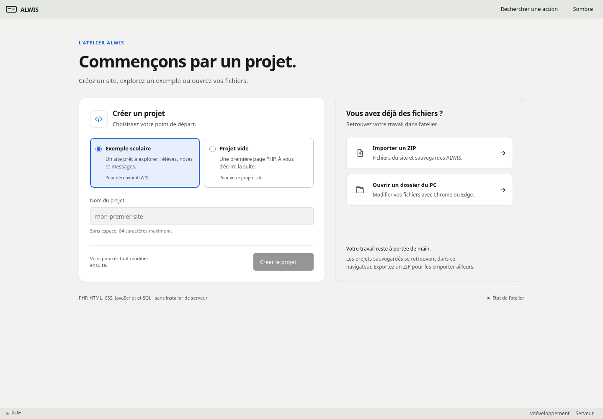
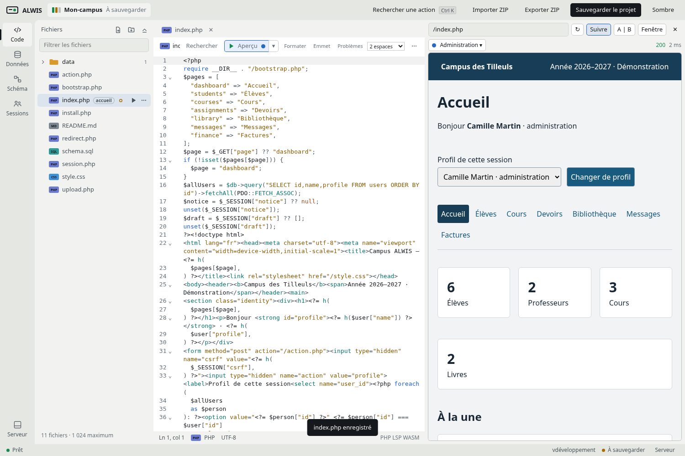
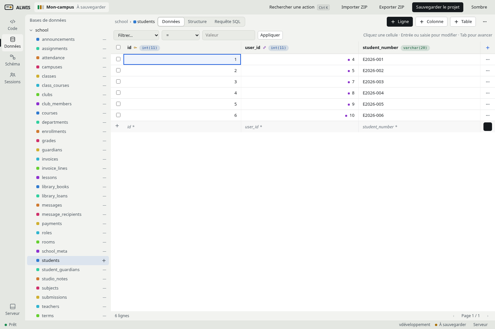

# Vos premiers pas avec ALWIS

[← Accueil](../README.md) · [Éditeur et sauvegardes](ide-workflows.md) · [Exemple Campus](school-example.md)

## 1. Créer un projet

1. Ouvrez ALWIS. [Besoin de l’installer ?](../README.md#démarrer)
2. Saisissez un nom, par exemple `Mon-campus`.
3. Choisissez **Exemple scolaire**, puis créez le projet.

<picture>
  <source media="(prefers-color-scheme: dark)" srcset="images/alwis-start-dark.png">
  
</picture>

> [!TIP]
> Le Campus contient déjà des pages et des données. Vous pouvez essayer sans partir de zéro.

## 2. Modifier une page

1. Dans **Code**, cliquez sur un fichier à gauche.
2. Modifiez son contenu.
3. Faites **Ctrl + S**, puis ouvrez **Aperçu**.

<picture>
  <source media="(prefers-color-scheme: dark)" srcset="images/alwis-code-dark.png">
  
</picture>

| Outil | À quoi sert-il ? |
|---|---|
| **Formater** | Ranger le code et son indentation |
| **Emmet** | Transformer une abréviation en HTML ou CSS |
| **Problèmes** | Lire les erreurs et les corrections proposées |
| **2 espaces / 4 espaces / Tabulations** | Choisir le décalage des lignes |

[Voir les exemples et raccourcis →](ide-workflows.md#écrire-plus-vite)

## 3. Explorer les données

1. Ouvrez **Données**.
2. Dépliez la base **school**, puis cliquez sur **students**.
3. Double-cliquez sur une cellule modifiable pour changer sa valeur.

| Onglet | Pour faire quoi ? |
|---|---|
| **Données** | Lire et modifier les lignes |
| **Structure** | Ajouter ou modifier une colonne |
| **Requête SQL** | Écrire une requête, par exemple `SELECT * FROM students;` |

Un second clic sur le nom de la base replie sa liste. Les bases **système**, grisées, servent au moteur.

## 4. Comprendre les liens

Ouvrez **Schéma** : chaque bloc est une table, chaque trait représente un lien.

- **Réorganiser** rapproche les tables liées.
- Déplacez une table par son en-tête.
- **Ajouter une colonne dans Données…** ouvre le formulaire complet.

**Exemple :** une note appartient à un élève. Le lien relie la table des notes à celle des élèves.

## 5. Essayer plusieurs visiteurs

Dans **Sessions**, ouvrez une page pour **Professeur**, puis pour **Élève**.

Les visiteurs partagent le même site et la même base, mais gardent leurs propres cookies et leur identité.

[Essayer une note ou un message →](school-example.md)

## 6. Garder une copie

| Action | Résultat |
|---|---|
| **Ctrl + S** | Le fichier actif est prêt à être exécuté |
| **Sauvegarder le projet** | Tous les brouillons et les bases sont conservés dans ce navigateur |
| **Exporter ZIP** | Une copie des fichiers et bases est téléchargée sur le PC |

Sur petit écran, retrouvez le ZIP dans le menu du projet, en haut.

> [!IMPORTANT]
> Le ZIP est votre copie transportable. Les sessions des visiteurs ne sont pas incluses.

## Un problème ?

| Ce qui arrive | Quoi faire |
|---|---|
| Du code est souligné | Ouvrez **Problèmes** |
| La page PHP ne fonctionne pas | Ouvrez **Serveur** et lisez le journal |
| Serveur affiche un nombre d’erreurs | Consultez le journal : le compteur revient à zéro, l’historique reste |
| Un fichier a changé ailleurs | Gardez une copie du brouillon avant de recharger |

[Limites connues](compatibility.md) · [Dossier du PC et ZIP](ide-workflows.md#ouvrir-un-dossier-du-pc) · [Documentation technique](../CONTRIBUTING.md)
