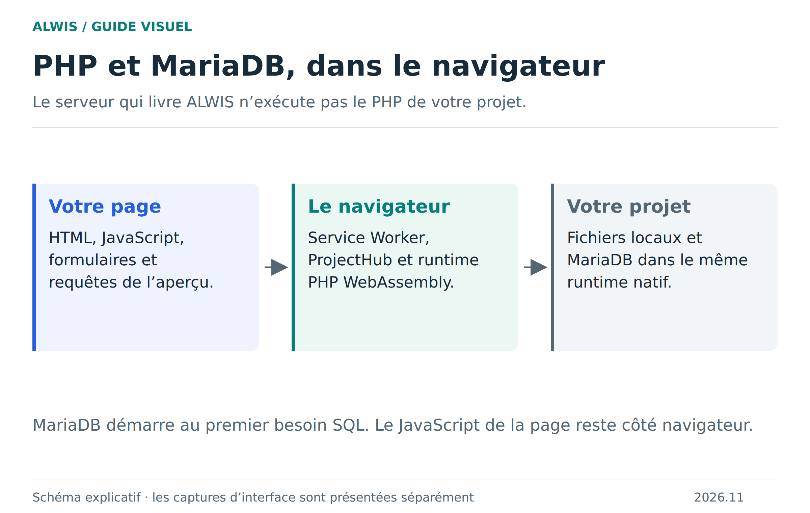
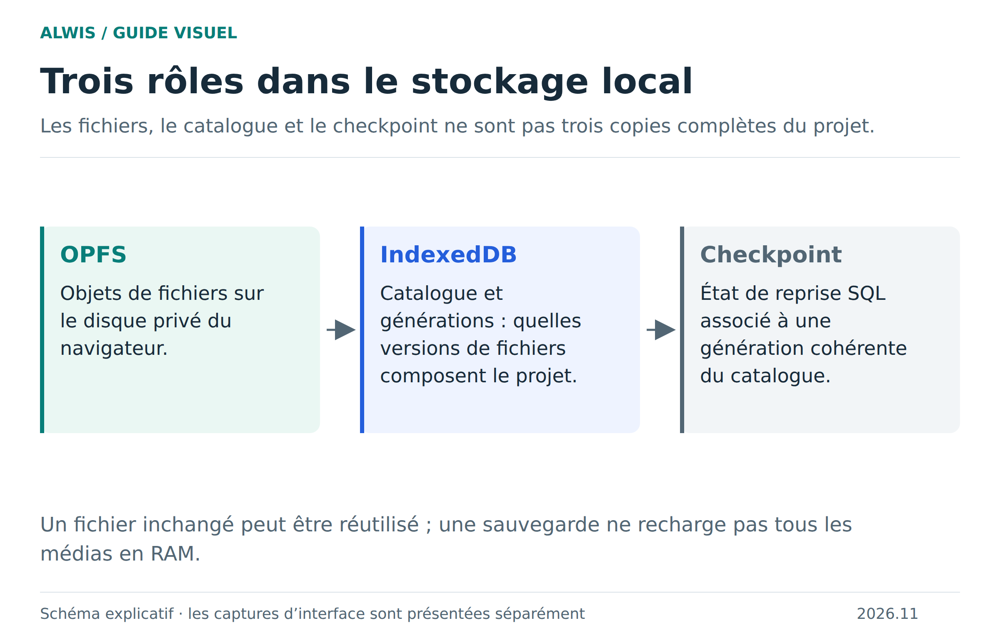

# Architecture : un projet web dans un navigateur

ALWIS sépare le studio, l’exécution du projet et les services de partage. Cette séparation explique où chercher une panne, ce qui reste local et pourquoi un conteneur serveur n’est pas un hébergement PHP classique.

[Version SVG](figures/execution.svg)

## Interface et coordination

Le studio fournit les vues Code, Données, Schéma et Sessions. Le ProjectHub coordonne l’état du projet et les opérations autorisées. Les composants de transport ne doivent pas accéder librement à toutes les fonctions du runtime : ils présentent des opérations bornées et contrôlées.

L’aperçu utilise le Service Worker pour relier des requêtes web aux fichiers et scripts du projet. Il conserve la méthode, les en-têtes, le corps et l’identité du visiteur. [Trajet HTTP détaillé](http-runtime.md).

## Un runtime natif PHP et MariaDB

Le build indépendant réunit PHP 8.4.27 et MariaDB dans un module WebAssembly, avec un worker d’orchestration JavaScript. MariaDB est initialisé au premier besoin SQL. PDO et MySQLi accèdent au moteur embarqué ; ils ne contactent pas automatiquement une base distante.

Le worker exécute une requête PHP à la fois. Asyncify permet d’attendre certaines opérations asynchrones, notamment Fetch ; il ne rend pas l’exécution PHP arbitrairement parallèle ou réentrante. Les sous-requêtes PHP dynamiques vers ce même moteur sont refusées pour éviter un auto-blocage.

Le build utilise Emscripten 6.0.6. Les entiers PHP restent sur 32 bits ; les grands entiers SQL sont conservés sous forme textuelle exacte par les adaptateurs. [Valeurs et conversions](sql-values.md) · [Reconstruction du moteur](native-qa-build.md).

## Stockage et générations

[Version SVG](figures/stockage.svg)

Les contenus volumineux utilisent le stockage disque du navigateur quand il est disponible, tandis que le catalogue et les générations permettent de retrouver un point de reprise cohérent. La sauvegarde du projet associe fichiers et bases SQL. L’export ZIP produit un format transportable ; les sessions privées des visiteurs sont exclues.

Les limites de fichiers, d’archives et de mémoire répondent à des contraintes différentes. Le maximum de mémoire WASM ne représente pas la consommation totale du navigateur. [Stockage détaillé](storage-opfs.md) · [Mémoire](performance-summary.md).

## Hôte et invités

Le navigateur hôte conserve le projet et exécute les requêtes des invités. Les visiteurs utilisent des sessions PHP distinctes et une base commune. L’édition serveur fournit la signalisation et le relais nécessaires ; l’aperçu HTTP invité fonctionne sur une origine HTTPS séparée. Sans cette configuration, un aperçu de compatibilité peut rester limité à des instantanés sans scripts.

Le conteneur peut conserver ses réglages d’administration dans SQLite. Cette base de configuration n’est pas la MariaDB des projets. [Collaboration](collaboration.md) · [Rôle du serveur](server-deployment.md).

## Erreurs, frontières et sécurité

Le cycle PHP nettoie les connexions et transactions abandonnées. Le runtime est refusé pour les requêtes suivantes si un état natif non réutilisable est détecté. Une transaction SQL annulée ne rembobine pas les fichiers déjà écrits par PHP. Les limites de débits et de volumes s’ajoutent à la séparation des origines, sans fournir une isolation de conteneur adversarial.

Le code partagé reste du code à évaluer avec prudence. Les profils fictifs du Campus et les pseudonymes d’invitation ne constituent pas une identité forte. Les validations navigateur attestent des parcours testés, pas une preuve de sécurité exhaustive.

## Lire les sources

Partez de `apps/studio/` pour l’interface, de `packages/runtime/` pour l’exécution, de `server/` pour les services et de `scripts/` pour la construction et la publication. Les tests navigateur sont dans `tests/browser/`. La [référence de parité](runtime-parity.md) donne les preuves et les limites de la version publiée.
