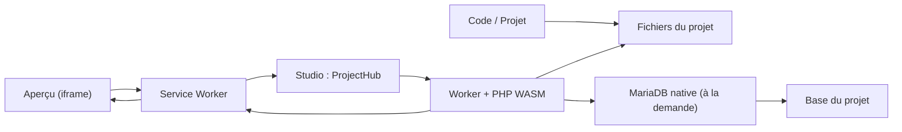
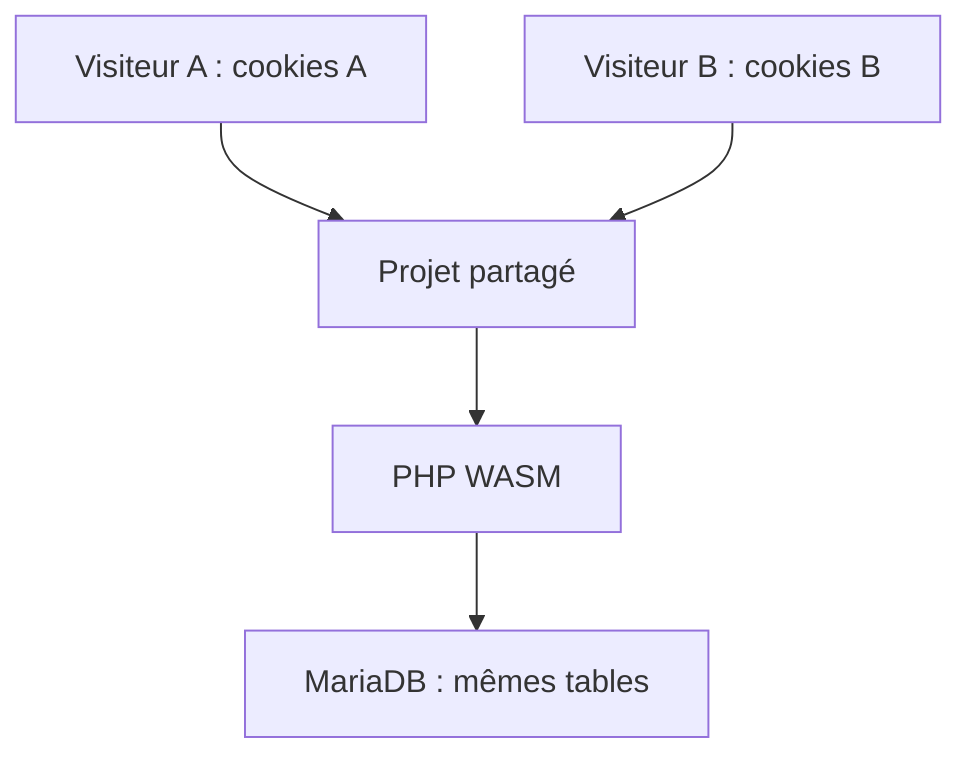
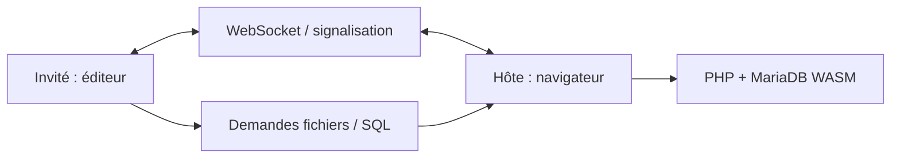

# Architecture d'ALWIS

[Premiers pas](README.md) · [Collaboration](collaboration.md) · [Stockage](storage-opfs.md) · [Limites](compatibility.md)

**ALWIS est un studio web : le navigateur exécute PHP et MariaDB, pas le serveur HTTP.** Un conteneur Docker peut servir l'application et la signalisation collaborative, sans devenir le serveur SQL du projet.

## 1. Un aperçu PHP, sans serveur PHP distant

- Le **Service Worker** reçoit les requêtes de l'aperçu et les envoie au studio qui possède le projet.
- Le **ProjectHub** charge les fichiers et demande au runtime PHP d'exécuter les scripts.
- **MariaDB démarre au premier besoin SQL.** PHP et MariaDB sont liés dans un même runtime WASM, mais l'initialisation SQL est différée.
- Le résultat revient comme une réponse HTTP normale : HTML, CSS, médias, redirections, cookies ou erreur.

## 2. Un projet, plusieurs visiteurs

Chaque session virtuelle a ses **cookies et sa session PHP**. Tous les visiteurs d'un projet utilisent les **mêmes fichiers et la même base SQL**.

Cela sert à tester un site avec un élève et un professeur, par exemple. Cette séparation reproduit des usages courants ; elle ne crée pas une frontière de sécurité contre du code hostile.

## 3. Où vont les données ?

| Élément | Endroit |
| --- | --- |
| Code et fichiers du projet | Stockage local du navigateur et cache du runtime |
| Base SQL | MariaDB WASM, avec sauvegarde locale du projet |
| Sessions PHP et cookies | Isolation virtuelle par visiteur |
| ZIP exporté | Fichier téléchargé sur le PC |
| Configuration d'un serveur Docker | SQLite dans le volume du conteneur |
| Travail collaboratif | Le navigateur hôte reste propriétaire des fichiers et de SQL |

**Sauvegarder et exporter ne sont pas équivalents.** Si le navigateur est effacé, les données locales peuvent disparaître. Exportez un ZIP pour conserver une copie transportable.

## 4. Que se passe-t-il en collaboration ?

L'hôte exécute le runtime. Les invités peuvent synchroniser le code et utiliser certaines commandes fichiers/SQL via l'hôte. Leur aperçu est actuellement une **copie du DOM**, sans exécution indépendante des scripts de la page. Un aperçu distant pleinement interactif demanderait un relais HTTP supplémentaire.

Voir [les fonctions et limites du partage](collaboration.md).

## 5. Où lire le code ?

| Composant | Chemin |
| --- | --- |
| Interface | `apps/studio/workbench/` |
| Routage d'aperçu | `apps/studio/service-worker.mjs` |
| Projet et sessions | `apps/studio/project-hub.mjs`, `packages/runtime/src/client-sessions.mjs` |
| Runtime PHP/SQL | `packages/runtime/src/native-runtime.mjs` |
| Adaptateurs SQL natifs | `packages/sql-native/` |
| Collaboration | `apps/studio/collab/`, `server/collab-hub.mjs` |
| Image serveur | `server/Dockerfile` |

**Limite de validation :** le patch natif MariaDB alternatif reste expérimental ; ses tests structurels n'attestent pas sa stabilité dans un WASM recompilé. Voir [l'état du remplacement](../engine/patches/INDEPENDENT-SESSION-MIGRATION.md) et [les droits de distribution](../LICENSE.md).
