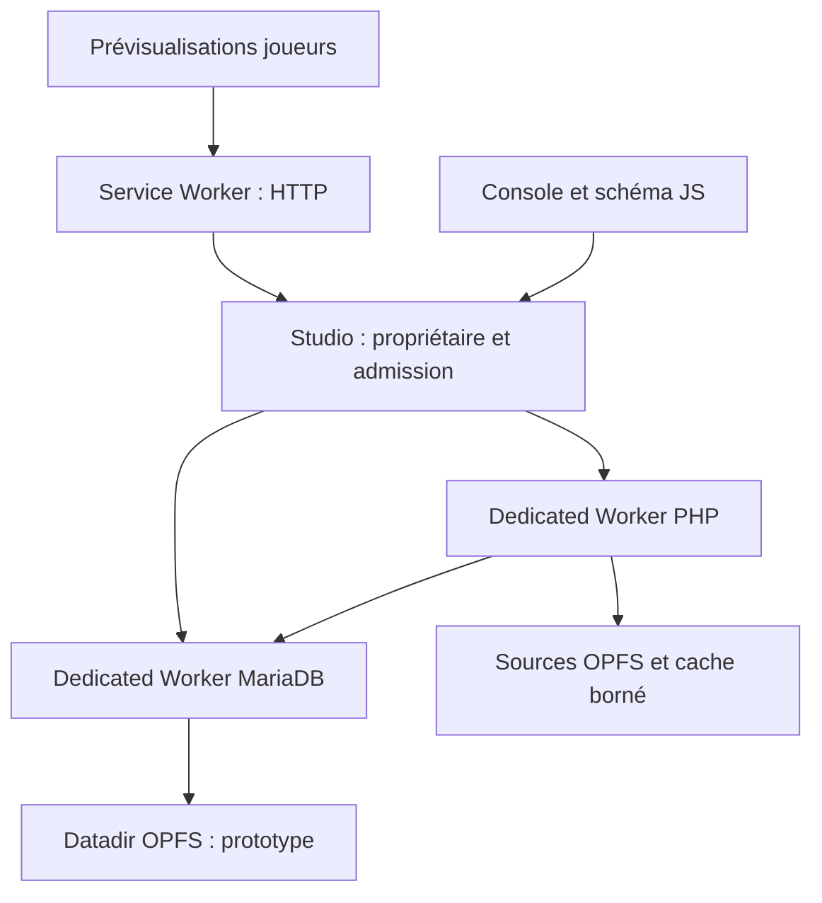

# Architecture et décisions

## Architecture cible

> Cadrage actualisé : voir [l’objectif actif](compatibility.md). N fenêtres avec sessions indépendantes ou partagées ; WASM unique PHP/MariaDB comme cible principale ; SQL à la demande et déchargement évalué sur mesures. Les scénarios à deux joueurs ci-dessous sont des tests, pas une limite produit.

## Propriétaire des moteurs et parcours HTTP

Le studio détient le verrou exclusif du projet (`navigator.locks`) et démarre les Dedicated Workers PHP et MariaDB. Les fenêtres de prévisualisation et de gestion ne démarrent aucun autre moteur pour ce projet.

Le Service Worker peut être arrêté par le navigateur : il ne possède pas la base et ne contient pas l'état durable du registre. À son redémarrage, il redécouvre le studio. Si le studio est fermé, il renvoie une erreur HTTP explicite et bornée dans le temps ; il ne recrée pas silencieusement une seconde base. Un second studio qui échoue à prendre le verrou reste client du premier.

Le studio restant ouvert ne garantit pas une exécution en arrière-plan illimitée : suspension d'onglet, veille et arrêt du navigateur doivent rester des cas de reprise.

## Identifiants et isolation

| Identifiant | Portée |
|---|---|
| `projectId` | Sources et données persistantes |
| `runtimeId` + génération | Propriétaire actif et redémarrage du moteur |
| `sessionId` | Joueur et cookie jar virtuel |
| `requestId` | Corrélation d'une requête/réponse |
| `ownerId` | Connexions et curseurs d'une requête PHP ou console |

Route proposée : `/run/<projectId>/<sessionId>/index.php`. Les URL absolues, redirections, chemins de formulaires et `fetch()` doivent conserver le contexte. Le runtime voit un document root cohérent sans préfixe artificiel dans ses chemins PHP.

Les cookies HTTP du site sont normalement communs aux onglets. Le coordinateur conserve donc un cookie jar **virtuel par session**, consomme les `Set-Cookie` de PHP et construit l'en-tête `Cookie` de la requête suivante. Les valeurs HttpOnly ne passent pas à l'application JS. Les scripts applicatifs qui lisent `document.cookie` ou utilisent des URL absolues devront faire partie des tests de compatibilité ; ne pas annoncer une isolation transparente avant ce test.

## Bus et admission

Reprendre les concepts de scopes de Playground, les gestionnaires CGI et le bus de Sean Morris. Choisir ce bus **ou** Comlink pour une frontière donnée. `BroadcastChannel` sert à découvrir le propriétaire et publier des invalidations ; `MessageChannel` sert aux échanges corrélés. Les messages comportent version, génération, identifiants et limites de taille. Nettoyer les ports et les callbacks à la fin ou à l'expiration.

La file JavaScript existante accepte une seule tâche active, au plus 32 en attente et 8 Mio d'octets déclarés actifs+en attente par défaut. Le caller doit déclarer les octets effectivement retenus et borner les métadonnées ; la classe ne mesure pas les closures JS. Un refus de surcharge doit devenir une réponse 503 avec stratégie de reprise côté client. Une annulation de fetch n'autorise pas à exécuter un second PHP avant que le premier ait effectivement fini.

## SQL natif commun

PDO adapté, MySQLi adapté et API JS console convergent vers le même contrat de backend. `packages/sql-native/include/pbl_sql.h` décrit les opérations et durées de vie proposées, sans implémentation ni ABI binaire stable.

| Opération | Exigence |
|---|---|
| Connexion | Session MariaDB réelle, base et charset explicites |
| Paramètres | NULL et binaire explicites ; pas de conversion BIGINT/DECIMAL en JS Number |
| Préparation | Implémenter de vraies préparations si API embarquée disponible ; sinon annoncer le mode émulé |
| Résultats | Métadonnées, lignes et erreurs ; buffers bornés avec curseur |
| Transactions | begin/commit/rollback par connexion, état conservé pendant la requête |
| Nettoyage | Fermer seulement les ressources du propriétaire terminé |
| Persistance | Barrière explicite après checkpoint et flush du VFS |

Le backend séparé ne partage pas des pointeurs C entre modules. Il envoie des frames avec longueurs, offsets, tags de types, identifiants/générations et octets transférables. Dans le build fusionné, l'adaptateur peut appeler directement l'API C et éviter la sérialisation. Les buffers alloués par un module sont libérés par ce module.

MySQLi dépend de mysqlnd dans PHP moderne. Deux spikes C sont à comparer : interposer les méthodes connexion/résultats/statement de mysqlnd, ou adapter les points d'entrée de l'extension MySQLi au cœur commun. Le remplacement du seul transport socket n'est pas suffisant pour parler à l'API embarquée. Aucun protocole MySQL TCP n'est nécessaire pour l'objectif local.

`mysqli_store_result`, `fetch_all`, `data_seek` et PDO bufferisé impliquent potentiellement de garder tout un résultat. Une API par lots ne garantit donc pas à elle seule une RAM constante : définir un plafond, ou un spool OPFS avec index de positions si ces comportements sont promis. Ne pas modifier silencieusement leur sémantique.

## Fichiers

| Emplacement logique | Propriétaire | Cible |
|---|---|---|
| Sources PHP/HTML/CSS/JS | Worker fichiers/PHP | OPFS, cache de 4 Mio pour fichiers actifs |
| Médias | Worker fichiers | Lecture par blocs/flux, sans préchargement global |
| Sessions PHP | Runtime PHP | Répertoire réservé du projet, pas celui des sources publiques |
| Datadir MariaDB | Worker DB uniquement | Backend OPFS natif à valider |
| Métadonnées UI | Studio | IndexedDB ou petit fichier séparé |
| JS/WASM immuables | Navigateur | Cache HTTP/Cache Storage versionné |

Un cache ne constitue pas le système de fichiers. Les `stat`, `open`, `read`, `write`, `seek`, `rename`, `unlink`, `truncate` et `fsync` de PHP/MariaDB exigent une adaptation réelle. Les sync access handles OPFS restent en Dedicated Worker. Les handles et métadonnées doivent eux aussi être bornés.

## Console et schéma relationnel

Interface JavaScript à charger à la demande : SQL, grille paginée, schéma. Les positions des tables sont des métadonnées UI ; les tables/colonnes/relations viennent de `information_schema` et `SHOW CREATE TABLE`.

Geste structurel → SQL proposé → exécution sur la connexion console → réintrospection → notification des fenêtres. Le DDL MariaDB peut provoquer un commit implicite ; annuler un déplacement visuel et annuler un ALTER TABLE ne sont pas la même opération. Les modifications de données utilisent la clé primaire, y compris composite, et une détection de conflit.

## Variantes à comparer

La référence séparée est le témoin de conformité du jalon 3, non la cible produit. Deux modules dans le même Worker conserveraient deux mémoires WASM et leurs copies. La **cible du jalon 4 est un WASM unique** : elle requiert une chaîne Emscripten commune, des réglages pthread/Asyncify/JSPI compatibles et une convention d'allocateurs claire. Les mesures servent à corriger le coût total, les erreurs et la RAM ; un éventuel abandon technique de cette cible devrait être explicitement justifié plutôt que déduit d'un seul microbenchmark.

Le système de dossiers PC reste hors V1. Le multijoueur entre appareils nécessitera un transport vers l'hôte (par exemple WebRTC, signalisation et parfois TURN), sans réplication implicite d'IndexedDB.

## Cycle PHP et MariaDB retenu

Décision utilisateur du 1 novembre 2026 : simplifier le cycle de vie en conservant deux états utilisables, **PHP seul** et **PHP + MariaDB**, plutôt que chercher à arrêter puis redémarrer MariaDB dans le même WASM.

## Fonctionnement retenu

- À l'ouverture, PHP est disponible et MariaDB reste non initialisée. Le binaire commun contient toujours les deux moteurs : cela ne constitue pas encore un téléchargement PHP seul, ni une réduction de la capacité linéaire réservée.
- Les Workers auxiliaires SQL sont eux aussi chargés à la demande : 0 avant la première connexion, puis un pool borné de 16 dans ce profil. Asyncify attend leur chargement avant de démarrer MariaDB, sans rejouer la requête PHP. Les compteurs `pthreadWorkers` distinguent Workers créés, utilisés, inactifs et pic observé.
- La première ouverture native PDO MySQL ou MySQLi, ou une connexion de la console SQL, initialise MariaDB. La détection porte sur l'utilisation réelle du pilote ; aucune recherche de mots dans les fichiers PHP. PDO SQLite, par exemple, ne doit pas déclencher MariaDB.
- Ce premier démarrage fonctionne déjà dans l'instance courante : il ne nécessite ni redémarrage de PHP ni réexécution de la requête. `mysqli_init()` et `new mysqli()` sans arguments créent seulement l'objet PHP ; ils ne déclenchent pas MariaDB. `real_connect()` ou un constructeur avec arguments ouvre la connexion native.
- Une fois démarrée, MariaDB reste active jusqu'à la sauvegarde ou la fermeture du moteur. La fermeture d'une connexion PDO/MySQLi ou de la console ne signifie pas l'arrêt du serveur.
- La sauvegarde attend les requêtes acceptées, ferme proprement SQL, enregistre le snapshot, puis le studio crée un nouveau WASM. Le projet revient à PHP seul et la prochaine connexion peut réactiver SQL. Les fichiers, données SQL et sessions proviennent du snapshot ; piles PHP et connexions ne sont pas restaurées.
- Aucun arrêt/redémarrage SQL dans le même WASM n'est proposé. Après un arrêt ou une initialisation échouée, une nouvelle instance est requise. L'échec de sauvegarde reste visible et doit être résolu avant la reprise des clients.

La recréation d'un moteur ne doit **jamais rejouer automatiquement** une requête PHP déjà exécutée : un POST, un upload ou une écriture pourraient produire deux effets. Les fenêtres clientes restent ouvertes ; un rechargement éventuel est une nouvelle requête explicite. Aucun rejeu automatique n'est requis par le démarrage SQL actuel.

## Preuves et limites

Le démarrage paresseux est implémenté par `pbl_mysql_init_owner()` dans `packages/sql-native/src/pbl_mysql.c`, commun aux pilotes natifs et à la console. Les [preuves natives](../engine/fusion/NATIVE-RUNTIME-RECEIPT.md) et les [preuves de sauvegarde/récupération](../engine/fusion/STORAGE-RECOVERY-RECEIPT.md) décrivent les scénarios exécutés. L'abort du redémarrage SQL dans la même instance est conservé comme échec expérimental.

Un mode de préchauffage explicite « PHP + MariaDB dès l'ouverture » pourra appeler le même chemin natif ; il n'existe pas encore de sélecteur de mode dans l'interface. Une reconstruction imposée lors de la première activation n'apporterait ici aucun avantage démontré. Les économies de RAM navigateur restent à mesurer séparément de la capacité WASM et du tas occupé.

## Décisions et expériences à mener

> Cadrage actualisé : voir [l’objectif actif](compatibility.md). N fenêtres avec sessions indépendantes ou partagées ; WASM unique PHP/MariaDB comme cible principale ; SQL à la demande, conservé jusqu'à la sauvegarde ou la fermeture. Les scénarios à deux joueurs ci-dessous sont des tests, pas une limite produit.

Les décisions de périmètre viennent des demandes utilisateur ; les choix d'implémentation restent à valider par le témoin natif. Voir [le contexte](README.md) pour la chronologie.

| Sujet | Décision ou statut | Validation nécessaire |
|---|---|---|
| Exécution | PHP et MariaDB WASM dans le navigateur, pas de VM x86 | Premier build témoin |
| Compatibilité | PDO + MySQLi compilés, backend SQL commun | Types, erreurs, prepared, transactions, références PHP |
| MySQLi | Extension Zend C directe sur l’API embarquée commune, implémentée ; compléter sa compatibilité par inventaire | Fixtures natives et matrice de conformité ; ne pas annoncer la compatibilité complète |
| Moteurs | Une instance PHP et une MariaDB par projet actif | Verrou, génération, arrêt/reprise |
| Cycle SQL | PHP seul → activation native PDO/MySQLi/console → PHP + MariaDB ; après arrêt, nouveau WASM, aucun rejeu automatique de requête PHP | [Décision et limites](architecture.md) ; démarrage initial et récupération déjà vérifiés, sélecteur de préchauffage non implémenté |
| HTTP | Service Worker routeur, studio propriétaire des Workers | Headers, formulaires, redirections, cookies et sessions |
| Fenêtres clientes | N fenêtres, sessions virtuelles indépendantes ou partagées, même base | Deux joueurs + console sont un scénario, pas une limite ; valider rattachement et déconnexion arbitraires |
| Connexions | Propriétaires distincts PHP/console | Fin d'une requête sans fermer la console |
| Stockage | Cible OPFS sans miroir global ; témoin IDBFS incrémental | POSIX, fsync, quota, crash recovery, performances |
| RAM | Cache/file/résultats/threads/historique bornés | Mesures globales et pics sur scénarios identiques |
| Transport SQL | Réduire JSON/base64 ; buffers typés et curseurs | Exactitude binaire, BIGINT/DECIMAL, sémantique bufferisée |
| Fusion | **Cible principale au jalon 4**, après référence séparée vérifiée et mesurée | ABI commune, PDO, gain/coût total, reprise sur erreur, RAM et disponibilité SQL à la demande |
| Édition web | **CodeMirror 6 + services WASM `php-lsp`, SuperHTML, SWC ou Babel-light** ; définitions jQuery internes invisibles | [Orientation utilisateur et exigences](README.md) ; prototype de complétion et mesures de chargement/déchargement |
| UI SQL | JavaScript, SQL/données/diagramme ; chargement à la demande | DDL exécuté puis schéma relu ; échecs affichés |
| Interface du studio | Six espaces, actions et états définis ; anti-ai-slop prioritaire puis suite better-* demandée par l'utilisateur | [Contrat d'interface](README.md) et [revue rendue](README.md) ; journal borné, erreurs réelles, navigation clavier et contrastes vérifiés |
| Dossier PC | Reporté V2 | Permissions, cohérence et conflits externes |
| Réseau entre appareils | Chantier ultérieur avec un hôte unique | Signalisation/transport et reprise |
| WordPress | Compatibilité élargie après les fixtures scolaires | Installation, admin, médias, REST et persistance |
| Boogie | Non identifié | Dépôt ou fichiers du projet nécessaires |

Le contrat C décrit une intention, pas une ABI stable. Les budgets de `config/` ne sont pas appliqués aux moteurs. Les preuves historiques dans `provenance/` ne remplacent pas un nouveau test.

## Références GitHub retenues

Sources téléchargées le 31 octobre 2026. Les archives complètes préservent les notices ; aucune dépendance npm ni chaîne de compilation native n’a été installée.

| Dépôt / commit | Rôle | Éléments utiles | Limites / travail |
|---|---|---|---|---|
| [seanmorris/php-wasm](https://github.com/seanmorris/php-wasm/tree/1e1fb6703730759181e84c62bce35ee9129febb9) · `1e1fb6703730` | Runtime principal étudié | CGI, commandes, synchronisation incrémentale, extensions | À déplacer derrière le studio ; pas moteur dans SW |
| [joomengine/php-wasm](https://github.com/joomengine/php-wasm/tree/3b8cef42c020fbcbb6b41fad86716b7c8664b55b) · `3b8cef42c020` | Alternative de runtime | API HTTP et pilote PDO compilé | Autre épinglage du bridge ; ne pas combiner les versions sans tests |
| [joomengine/mariadb-wasm-bridge](https://github.com/joomengine/mariadb-wasm-bridge/tree/56d47b4dc867af313592efa09e12df470a36e129) · `56d47b4dc867` | Socle PDO et sessions SQL | Pilote C, hostcall, tests types/transactions, patch de sessions | JSON/base64, préparations émulées et reset global à adapter |
| [shyim/lite4mariadb](https://github.com/shyim/lite4mariadb/tree/24be9371a2f6c71250a2356631ad6feab2280b02) · `24be9371a2f6` | Moteur MariaDB embarqué | libmariadbd, InnoDB, CMake, API C/JS et Worker | IDBFS en mémoire, résultats bufferisés, profil 256 Mio/16 threads |
| [WordPress/wordpress-playground](https://github.com/WordPress/wordpress-playground/tree/a4dbcd0bf65a82e10a5d3821f5023aeee81097e6) · `a4dbcd0bf65a` | Architecture HTTP navigateur | SW, scopes, cookies, orchestration et request handler | Adapter partage entre fenêtres ; ne pas embarquer WordPress pour le socle |
| [php/php-src](https://github.com/php/php-src/tree/7ba31bb1934ae22c2d007135e89a38af131ec52e) · `7ba31bb1934a` | Contrats natifs PHP | MySQLi/mysqlnd/PDO et tests | HEAD est une référence de lecture, pas la version PHP à compiler pour le témoin |
| [emscripten-core/emscripten](https://github.com/emscripten-core/emscripten/tree/91d14a4c6729752ed146751416fe96598cac3dc7) · `91d14a4c6729` | VFS natif | WasmFS et backend OPFS C++/JS | HEAD de lecture ; bridge construit avec 6.0.6, intégration à revalider |
| [zen-fs/core](https://github.com/zen-fs/core/tree/ecb25b1bfd81879ef79052156c0171f215117b59) · `ecb25b1bfd81` | Comparaison de VFS | Interfaces et mixin Async | Inspecter préchargement/caches avant de choisir |
| [zen-fs/dom](https://github.com/zen-fs/dom/tree/d9d9288471c7825a5ead485440aa87dec3c38ee2) · `d9d9288471c7` | Comparaison de stockage navigateur | FileSystem handles et IndexedDB | WebAccessFS et accès OPFS natif ne sont pas interchangeables |
| [zen-fs/emscripten](https://github.com/zen-fs/emscripten/tree/c9d5c47d0a420e0fa05d635d106457bf56c17dc0) · `c9d5c47d0a42` | Adaptateur VFS | Montage dans les deux sens | Choisir un seul sens et éviter doubles copies |
| [kachurun/opfs-worker](https://github.com/kachurun/opfs-worker/tree/c8813394795bcb26a0030ea94697114c59ec5b7e) · `c8813394795b` | Référence opérations fichiers | Descripteurs, sync handles, streaming et notifications | readFile alloue tout ; privilégier des blocs pour gros fichiers |
| [GoogleChromeLabs/comlink](https://github.com/GoogleChromeLabs/comlink/tree/114a4a6448a855a613f1cb9a7c89290606c003cf) · `114a4a6448a8` | Alternative de RPC | expose, transfer, libération des proxies | Ne pas empiler les bus ni passer des pointeurs WASM |
| [drawdb-io/drawdb](https://github.com/drawdb-io/drawdb/tree/dc32c8bde614c931ec8bf3b3c346500d7626ab72) · `dc32c8bde614` | Inspiration éditeur relationnel | Tables, colonnes, relations et introspection MariaDB | Interface à relier à la vraie DB et au DDL |
| [chartdb/chartdb](https://github.com/chartdb/chartdb/tree/57bca690cc180f7501c6aa0c163c3b1dd418efa7) · `57bca690cc18` | Inspiration introspection/diagramme | Métadonnées MySQL et rendu des tables/relations | Comparer les petits éléments utiles, ne pas importer toute application |
| [outerbase/studio](https://github.com/outerbase/studio/tree/70c9d8e9745c161fb84746d3372bdab838c9bb36) · `70c9d8e9745c` | Inspiration console et grille | Pipeline de requêtes, résultats et générateur de schéma | Brancher au backend local et borner pages/historique |
| [xyflow/xyflow](https://github.com/xyflow/xyflow/tree/d4bc936edad07aba995dbdb8e2c63af8cdd631c9) · `d4bc936edad0` | Interactions du schéma | Nœuds, handles, arêtes, drag/zoom | Aucune validation SQL automatique |
| [codemirror/lang-sql](https://github.com/codemirror/lang-sql/tree/f5b0b0ba1811f87db2d1733f005585bd43322980) · `f5b0b0ba1811` | Éditeur SQL | Dialecte MariaSQL et complétion | Snapshot GitHub conservé ; le dépôt indique un nouvel hébergement |

La cartographie [CODE-MAP.md](README.md) descend jusqu’aux chemins, repères de lignes et intentions d’adaptation. `provenance/source-map.json` contient aussi les SHA-256 des fichiers.

## Sous-modules MariaDB

| Dépendance | Commit | État |
|---|---|---|
| [libmariadb](https://github.com/MariaDB/mariadb-connector-c/tree/5a6fe6016fc908518e7d2a8c128a5c108b511c17) | `5a6fe6016fc908518e7d2a8c128a5c108b511c17` | Archive téléchargée et vérifiée |
| [storage/rocksdb/rocksdb](https://github.com/facebook/rocksdb/tree/79f08d7ffa6d34d9ca3357777bcb335884a56cfb) | `79f08d7ffa6d34d9ca3357777bcb335884a56cfb` | Inventorié, module optionnel non téléchargé pour le profil réduit |
| [wsrep-lib](https://github.com/mariadb-corporation/wsrep-lib/tree/5eeef4009d52455c44b607e852cb23fbb6e84c99) | `5eeef4009d52455c44b607e852cb23fbb6e84c99` | Inventorié, module optionnel non téléchargé pour le profil réduit |
| [extra/wolfssl/wolfssl](https://github.com/wolfSSL/wolfssl/tree/1d363f3adceba9d1478230ede476a37b0dcdef24) | `1d363f3adceba9d1478230ede476a37b0dcdef24` | Archive téléchargée et vérifiée |
| [storage/maria/libmarias3](https://github.com/mariadb-corporation/libmarias3/tree/23873f4acb8038d8cccc5f0bc61c45ac07727f73) | `23873f4acb8038d8cccc5f0bc61c45ac07727f73` | Inventorié, module optionnel non téléchargé pour le profil réduit |
| [storage/columnstore/columnstore](https://github.com/mariadb-corporation/mariadb-columnstore-engine/tree/962e861c6a11e375cd95c78a517ab2b5d50e0076) | `962e861c6a11e375cd95c78a517ab2b5d50e0076` | Inventorié, module optionnel non téléchargé pour le profil réduit |
| [storage/duckdb/third_parties/duckdb](https://github.com/duckdb/duckdb/tree/8a5851971fae891f292c2714d86046ee018e9737) | `8a5851971fae891f292c2714d86046ee018e9737` | Inventorié, module optionnel non téléchargé pour le profil réduit |

## Références de spécification vérifiées

- [Emscripten — File System API](https://emscripten.org/docs/api_reference/Filesystem-API.html) : distinction VFS, persistance et WasmFS.
- [WHATWG — File System](https://fs.spec.whatwg.org/) : OPFS et exposition des sync access handles aux Dedicated Workers.
- [PHP RFC — Remove support for libmysql from mysqli](https://wiki.php.net/rfc/mysqli_support_for_libmysql) : depuis PHP 8.2, mysqli se construit avec mysqlnd.

## Pistes non retenues pour le socle

La conversation initiale comparait aussi MySQL/MariaDB sous Wasmtime et MySQL dans v86. Le socle vise un navigateur sans VM x86 ni serveur réseau externe : leurs sources ne sont donc pas incluses dans ce téléchargement ciblé. Leurs performances précédemment citées ne sont pas utilisées comme benchmarks de ce projet.

Boogie n’avait pas été identifié avec certitude dans la conversation source. Aucun dépôt n’est attribué à ce nom dans cette reconstruction.

