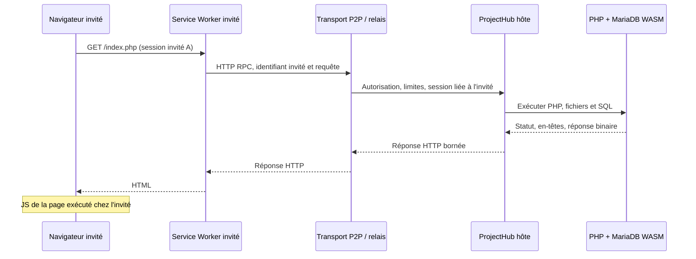

# Migration : aperçu HTTP invité sans miroir DOM

[Roadmap](https://github.com/Bastian-Noel/ALWIS/issues/1) · [Collaboration actuelle](collaboration.md) · [Parité PHP](runtime-parity.md)

## Objectif

Le navigateur invité **reçoit des réponses HTTP réelles et exécute son JavaScript local**. Il ne reçoit pas de snapshot DOM et ne compile pas de PHP/MariaDB. Toutes les requêtes PHP ou SQL passent par le navigateur hôte propriétaire du projet.

## Frontières à maintenir

1. **Session attribuée côté hôte :** l'invité ne fournit jamais son identifiant de session PHP ni un cookie hôte. Le hôte possède une paire identité invité ↔ session PHP créée à l'arrivée.
2. **Permission distincte pour l'aperçu :** un projet accessible en lecture seule peut cependant exécuter du PHP et modifier SQL. L'hôte doit activer explicitement ce droit.
3. **Limiter chaque requête :** nombre de clients actifs, en-têtes, corps, résultat, débit, timeout et taille des ressources. Les frames WebRTC/relais doivent être découpées, pas un JSON géant.
4. **Aucun rejeu automatique POST/PUT/PATCH/DELETE** après interruption ; sinon double paiement/écriture.
5. **Chemin et origine :** rejeter les origines distantes, accès aux fichiers cachés, en-têtes d'identification forgés et traversée de répertoires.
6. **Réponses :** préserver statuts, redirections, Content-Type, binaires, erreurs et cache-control, tout en traitant Set-Cookie dans le pot de cookies hôte.
7. **Si l'hôte disparaît :** réponse 503 visible, pas de faux contenu ou de données figées sans indication.
8. **Isolation non garantie contre un invité malveillant** : toute exécution de code dans le même domaine doit être revue avec une véritable stratégie de sandbox/origine et d'autorisations avant activation générale.

## État de livraison

- **Terminé :** contrat first-party `apps/studio/collab/http-contract.mjs`, protocole binaire en frames `http-frames.mjs`, passerelle hôte/invité `http-gateway.mjs` (mock validé avec deux sessions distinctes), réutilisation du point d'entrée `sessions.route` de `ProjectHub`. L'autorisation reste désactivée par défaut, sans connexion au Service Worker invité.
- **À faire :** liaison au Service Worker invité et au transport de salle, contrôle d'opt-in de l'hôte, cookies synchronisés sans fuite entre origines, backpressure et contrôle de débit, nettoyage garanti à la déconnexion, tests navigateur bout à bout et mesure des performances.
- **En attendant :** l'aperçu existant reste un miroir DOM ; aucun mode HTTP distant n'est prétendu actif.
