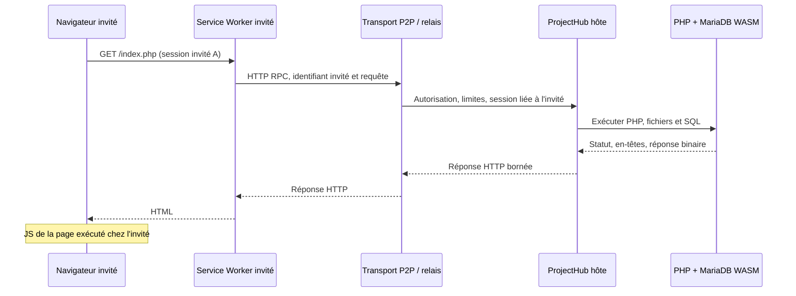

# Migration : aperçu HTTP invité sans miroir DOM

[Roadmap](https://github.com/Bastian-Noel/ALWIS/issues/1) · [Collaboration actuelle](collaboration.md) · [Parité PHP](runtime-parity.md)

## Objectif

Le navigateur invité **reçoit des réponses HTTP réelles et exécute son JavaScript local**. Il ne reçoit pas de snapshot DOM et ne compile pas de PHP/MariaDB. Toutes les requêtes PHP ou SQL passent par le navigateur hôte propriétaire du projet.

## Frontières à maintenir

1. **Session attribuée côté hôte :** l'invité ne fournit jamais son identifiant de session PHP ni un cookie hôte. Le hôte possède une paire identité invité ↔ session PHP créée à l'arrivée.
2. **Permission distincte pour l'aperçu :** un projet accessible en lecture seule peut cependant exécuter du PHP et modifier SQL. L'hôte doit activer explicitement ce droit.
3. **Limiter chaque requête :** nombre de clients actifs, en-têtes, corps, résultat, débit, timeout et taille des ressources. Les frames WebRTC/relais doivent être découpées, pas un JSON géant.
4. **Aucun rejeu automatique POST/PUT/PATCH/DELETE** après interruption ; sinon double paiement/écriture.
5. **Chemin et origine :** rejeter les origines distantes, accès aux fichiers cachés, en-têtes d'identification forgés et traversée de répertoires.
6. **Réponses :** préserver statuts, redirections, Content-Type, binaires, erreurs et cache-control, tout en traitant Set-Cookie dans le pot de cookies hôte.
7. **Si l'hôte disparaît :** réponse 503 visible, pas de faux contenu ou de données figées sans indication.
8. **Isolation non garantie contre un invité malveillant** : toute exécution de code dans le même domaine doit être revue avec une véritable stratégie de sandbox/origine et d'autorisations avant activation générale.

## État de livraison au 10 novembre 2026

Le **circuit HTTP invité est raccordé en mode optionnel**, mais la parité
navigateur d'un site PHP interactif complet n'est pas encore démontrée. Ne pas
confondre tests unitaires de transport et validation réelle sur deux invités.

| Sous-système | État vérifiable | Limite avant généralisation |
|---|---|---|
| Contrats et trames binaires | `http-contract.mjs`, `http-frames.mjs`, budget 8 Mio par corps | Débit, mémoire et annulations sur liaison dégradée à mesurer |
| Contrôle de débit | `http-flow.mjs` : huit trames (~48 Kio) en attente d'ACK maximum | Tester relais/WebRTC sous latence et déconnexion réelles |
| PHP et SQL chez l'hôte | `HostHttpGateway` route via `ProjectHub`, sessions distinctes par identité invitée | Vérifier la persistance/transaction et les fichiers sur deux vrais navigateurs |
| Service Worker invité | `service-worker.mjs` intercepte `/__pbl-guest/<canal>/…`, passe par `GuestPreviewController` et `GuestHttpGateway` | Tester navigation, POST, redirections, ressources et `fetch()` en navigateur |
| Cookies invités | Cookie virtuel géré par l'hôte ; `Set-Cookie` retiré du transport brut | Vérifier HttpOnly, SameSite et absence de fuite à travers les origines |
| Autorisation | `setPreviewAllowed` distinct de l'édition ; désactivé par défaut | Tester retrait de permission pendant une requête active |
| Sécurité du rendu | `preview-security.mjs` interdit l'association `allow-scripts` + `allow-same-origin` | L'origine opaque peut perturber service workers, fetch et stockage ; tester avant activation générale |
| Repli actuel | Miroir DOM conservé lorsque l'aperçu HTTP n'est pas autorisé | Supprimer du parcours normal uniquement après parité multiutilisateur |

### Acceptation du véritable aperçu multiutilisateur

La migration ne sera considérée complète que si deux invités peuvent :

1. ouvrir `/index.php` indépendamment et obtenir le HTML exécuté chez l'hôte ;
2. utiliser le JavaScript du site, les ressources et `fetch()` depuis **leur propre navigateur** ;
3. envoyer des POST binaires et des formulaires sans duplication, avec erreurs 503 si l'hôte disparaît ;
4. conserver des sessions PHP/cookies distincts tout en partageant les mêmes fichiers et données MariaDB ;
5. recevoir la révocation de la permission d'aperçu sans possibilité de contourner l'hôte.

Ces scénarios nécessitent Chromium **et** Firefox avec une origine réellement
isolée pour la page invitée. Tant que ces vérifications ne passent pas, le
raccordement expérimental reste optionnel et la production ne doit pas adopter
ce parcours comme aperçu principal.
