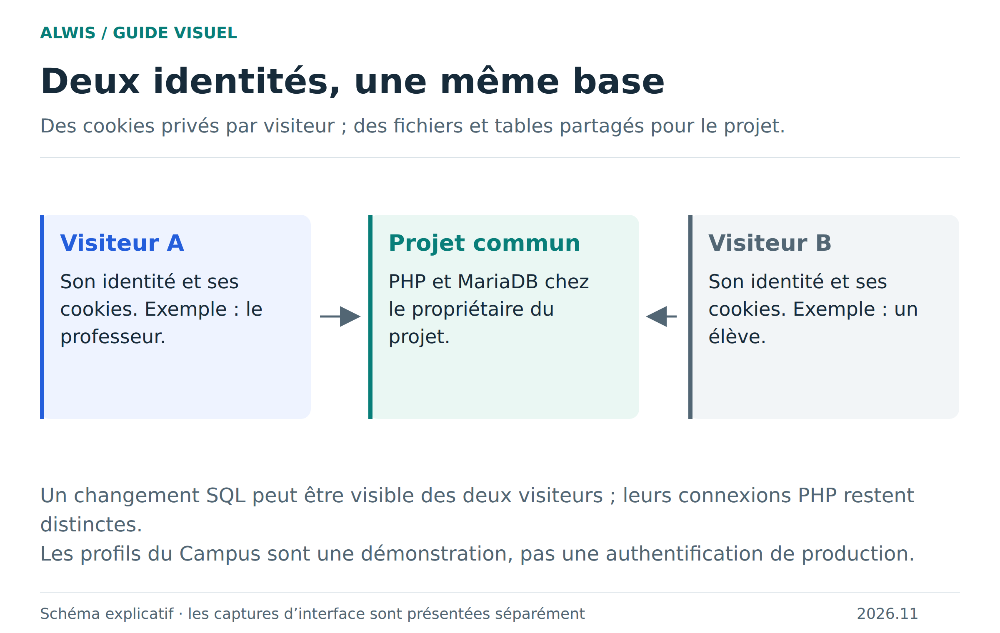
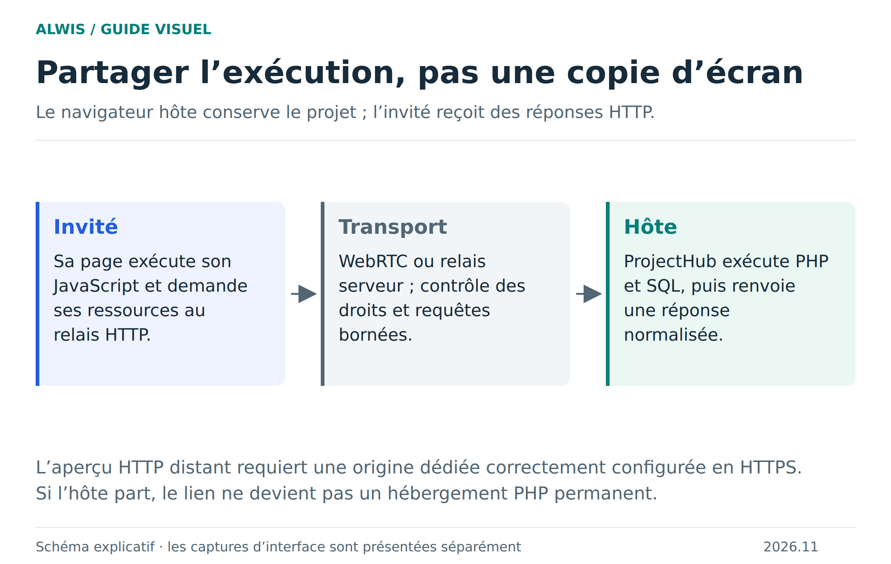

# Collaborer : partager le travail et tester des visiteurs

ALWIS distingue les visiteurs de votre aperçu local et les personnes qui rejoignent une salle depuis un autre navigateur. Dans les deux cas, plusieurs identités peuvent utiliser une même application ; le transport et la configuration ne sont pas les mêmes.

## Les visiteurs locaux

La vue Sessions permet de tester des cookies et sessions PHP séparés. Les fichiers du projet et la base SQL restent partagés. Dans le Campus, changer le profil d’un visiteur ne doit pas connecter les autres au même profil.

Ces profils sont fictifs et sans mot de passe. Ils montrent le comportement d’une application multiutilisateur ; ils ne constituent pas une solution d’authentification sécurisée.

## Les invités distants

Le propriétaire ouvre une salle et partage son lien. Les invités rejoignent avec les droits que l’hôte leur accorde. L’édition synchronisée, la présence et les opérations sur les fichiers ou SQL passent par le protocole de collaboration. Le runtime et le stockage du projet restent chez l’hôte.

L’aperçu HTTP invité peut exécuter les scripts de la page dans le navigateur invité et transmettre ses requêtes PHP à l’hôte. Les cookies et sessions sont individualisés, tandis que les changements SQL sont communs. Deux vrais invités et ce partage de données ont été testés dans Chromium et Firefox sur le runtime indépendant.

## Conditions de fonctionnement

Le serveur doit fournir la signalisation en HTTPS/WSS et le passage de l’en-tête `Upgrade` par le proxy. ALWIS favorise le P2P et utilise le serveur en repli. Le badge **P2P** ou **Relais serveur** est visible par participant dans la fenêtre de partage ; les limites partagées du relais y sont indiquées lorsqu’il est utilisé.

Deux variables règlent l’aperçu invité : `ALWIS_PREVIEW_MODE=static|interactive` et `ALWIS_PREVIEW_URL`. Le mode statique est le défaut. Le mode interactif peut utiliser une origine HTTPS distincte, y compris un sous-domaine ; si aucune origine séparée n’est configurée, l’invité doit confirmer sa confiance au projet. Cette confirmation autorise ses scripts à accéder au studio invité et à son stockage local. Un refus ou un échec garde le miroir sans scripts. La publication du ZIP FTP ne configure pas à elle seule ce service distant.

[Configurer l’origine et le serveur](server-deployment.md) · [Trajet HTTP détaillé](http-runtime.md)

## Ce que signifie « partager »

L’hôte doit rester disponible. Fermer son navigateur ne transforme pas la salle en hébergement permanent. Une reconnexion peut rétablir la participation, mais un navigateur absent ne peut exécuter les requêtes PHP.

Vérifiez les droits avant une modification et retirez l’accès lorsque la séance se termine. Un pseudonyme n’est pas une preuve d’identité. Le partage n’isole pas du code hostile comme le ferait un conteneur dédié à chaque personne. Les sauvegardes et les exportations restent la responsabilité du propriétaire du projet.

## Vérifier votre installation

Commencez avec deux contextes navigateur distincts, ouvrez une même application, donnez-leur des profils différents et modifiez une donnée SQL. Vérifiez la séparation des sessions et la visibilité de la donnée commune. Testez ensuite la déconnexion de l’hôte et le retrait d’un invité. N’inférez pas la réussite de l’aperçu HTTP du seul fait que l’éditeur synchronise du texte.

[Preuves des tests](runtime-parity.md) · [Dépannage](troubleshooting.md) · [Plan historique de migration](collaboration-http-migration.md)

## Déplacements du schéma et présence dans les dossiers

Les positions des tables sont communes : déplacer une table met à jour les autres participants pendant le déplacement. Les nouveaux invités retrouvent ce placement et l’hôte le conserve avec **Enregistrer**. Le zoom et le cadrage restent personnels, sauf si vous choisissez de suivre quelqu’un. Vous pouvez aller à gauche et au-dessus de l’origine ; près des bords, le déplacement entraîne le panoramique. Les flèches du clavier déplacent aussi une table sélectionnée.

Dans l’explorateur, l’avatar d’une personne apparaît près de son fichier ouvert. Si ce fichier est caché par un dossier replié, l’avatar remonte sur ce dossier. Dépliez-le pour retrouver l’indicateur sur le fichier.
