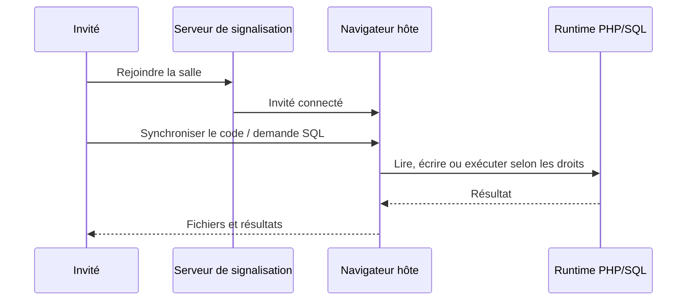

# Collaborer sur ALWIS

[Architecture](architecture.md) · [Hébergement](server-deployment.md)

Le mode collaboratif sert à **éditer et explorer un même projet depuis plusieurs navigateurs**. L'instance serveur doit activer la collaboration ; la version statique ne fournit pas de relais central permanent.

## Comment ça marche ?

Le propriétaire du projet **reste le navigateur hôte**, qui conserve les données et le runtime. Un invité ne démarre pas un autre PHP/MariaDB pour le projet partagé.

## Fonctions existantes

- **Salon et invitation** : lien de partage, pseudo, reconnexion et gestion d'une participation.
- **Édition synchronisée** : propagation des modifications et présence dans l'éditeur.
- **Fichiers et SQL** : les outils de l'invité appellent des opérations autorisées sur l'hôte, avec limites de volume et de concurrence.
- **Présence et focus** : pastilles, sélection et zones actives des participants.
- **Aperçu suivi** : l'hôte envoie une représentation HTML de son aperçu, avec certains événements rejoués côté hôte.

## Ce qui n'est pas encore équivalent à un vrai navigateur invité

L'aperçu invité est **un miroir DOM**, pas une deuxième session PHP/HTTP distante exécutant librement JavaScript. Certains formulaires, scripts et interactions ne fonctionnent donc pas exactement comme dans un navigateur autonome.

L'accès du navigateur invité dépend également de la connexion et de la disponibilité de l'hôte. Un lien de partage n'est pas un hébergement permanent.

## Sécurité et exploitation

- Ne pas utiliser les pseudonymes comme preuve d'identité ; conserver une validation des droits côté hôte.
- Limiter connexions, débits, fichiers, requêtes et résultats ; éviter toute opération libre sur le serveur.
- Utiliser HTTPS/WSS et le bon passage de l'en-tête `Upgrade` sur le reverse proxy.
- Les fichiers de projet et la base restent dans le navigateur de l'hôte ; les paramètres de l'instance Docker peuvent être persistés dans SQLite.
- Le code partagé et ses droits ne sont pas isolés comme des conteneurs adversariaux : ne pas accueillir de code non fiable sans protection adaptée.

## Fichiers importants

`server/collab-hub.mjs` (salles et transport) · `apps/studio/collab/wire.mjs` (hôte et invité) · `apps/studio/collab/rpc.mjs` (opérations autorisées) · `apps/studio/collab/preview.mjs` (miroir d'aperçu).

Les tests unitaires sont `tests/collab-*.test.mjs`. Ils vérifient l'orchestration et les contrôles du protocole, mais ne démontrent pas la sécurité en présence d'adversaires ni un aperçu HTTP distant complet.

## Évolution utile

Un vrai aperçu interactif pour chaque invité nécessiterait un routage **Service Worker invité → RPC HTTP → ProjectHub hôte**, avec identités PHP isolées, ressources binaires, cookies et politiques d'accès explicites. Ce n'est pas encore la fonctionnalité livrée.
