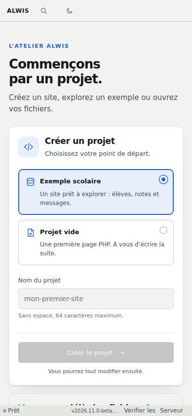

# Compatibilité et limites à connaître

ALWIS permet d’exécuter et d’explorer des projets PHP/SQL dans le navigateur. Sa compatibilité doit se lire fonction par fonction : une page PHP simple, une extension native particulière et un serveur réseau complet ne demandent pas les mêmes capacités.

## Navigateurs

**Chromium et Firefox** sont couverts par les validations automatisées du runtime indépendant et les parcours réels du studio. Les tests vérifient notamment PHP/PDO/MySQLi, les requêtes HTTP, les sessions et la reprise après erreur. Edge partage la base Chromium, mais ne doit pas être présenté comme une validation dédiée. Safari ne dispose pas ici d’une validation complète équivalente.

L’accès direct à un dossier du PC dépend des API et permissions du navigateur. Le ZIP reste la voie de transport à privilégier quand cet accès n’est pas disponible. Les navigateurs mobiles peuvent imposer des contraintes supplémentaires de mémoire, stockage et confort d’édition.

## PHP et SQL

Le moteur publié utilise PHP 8.4.27 et MariaDB dans un même WASM. PDO et MySQLi sont couverts par les tests ; cela ne signifie pas que toutes les extensions PHP d’un hébergement classique sont disponibles. Les entiers PHP sont signés sur 32 bits. Les valeurs SQL plus grandes doivent conserver leur forme exacte, souvent textuelle. [Guide des valeurs](sql-values.md).

Un seul script PHP s’exécute à la fois dans ce runtime. Il ne s’agit pas d’un pool de processus PHP-FPM. Les sous-requêtes dynamiques PHP vers le même moteur sont refusées pour éviter un blocage. La parallélisation native supplémentaire reste un sujet d’évolution.

## Réseau et services externes

Les appels HTTP PHP utilisent Fetch et restent soumis à CORS/TLS. Le sous-ensemble cURL ne fournit pas les sockets TCP, `curl_multi`, les proxys CONNECT ou une configuration TLS arbitraire. Un projet qui attend Redis, un serveur SMTP ou une extension réseau spécifique n’est pas automatiquement portable. [Référence HTTP/cURL](http-compatibility.md).

## Stockage et mémoire

Les quotas du navigateur peuvent être plus petits que les limites ALWIS. Effacer les données du site, changer d’origine ou travailler en navigation privée affecte la conservation. Exportez des copies indépendantes.

La mémoire WASM commence à 256 Mio et peut atteindre 512 Mio dans la configuration publiée ; ce n’est pas une promesse de RAM totale du navigateur. Les fichiers, interfaces et tampons d’export ajoutent leurs allocations. [Mémoire en bref](performance-summary.md) · [Budgets de stockage](storage-opfs.md).

## Collaboration et publication

L’aperçu distant interactif exige un hôte disponible, les droits appropriés et une origine HTTPS dédiée. Le studio statique peut être essayé sans cette infrastructure. Les profils Campus sont démonstratifs et sans mot de passe.

La publication 2026.11 Beta 1 conserve une exception de licence sur deux fichiers historiques PHP ; les tests fonctionnels ne valent pas autorisation des tiers. Consultez [l’état de licence](../provenance/release-licensing-status.json).

[Installer](installation.md) · [Dépanner](troubleshooting.md) · [Voir les preuves de validation](runtime-parity.md)
