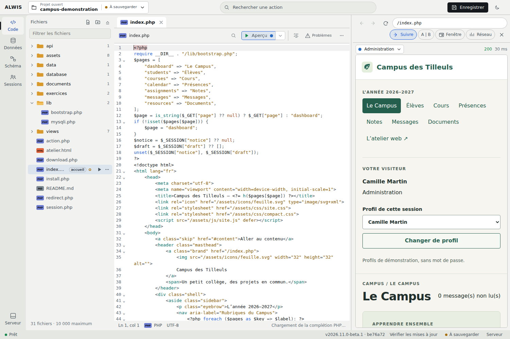
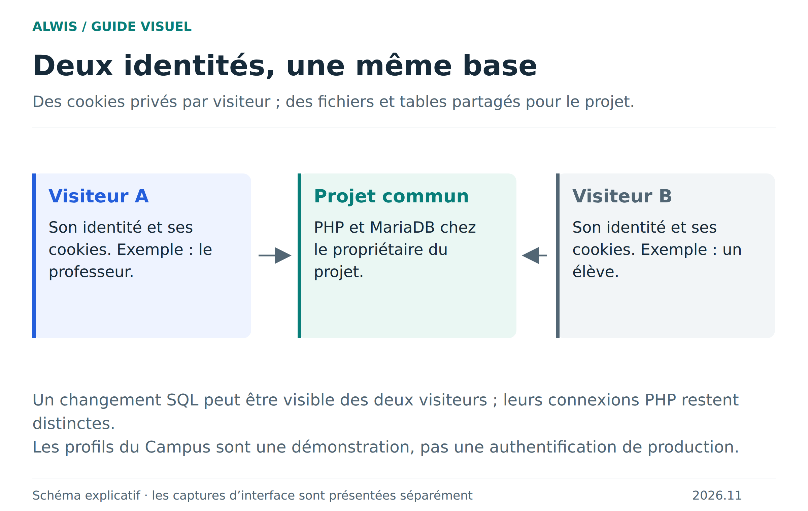
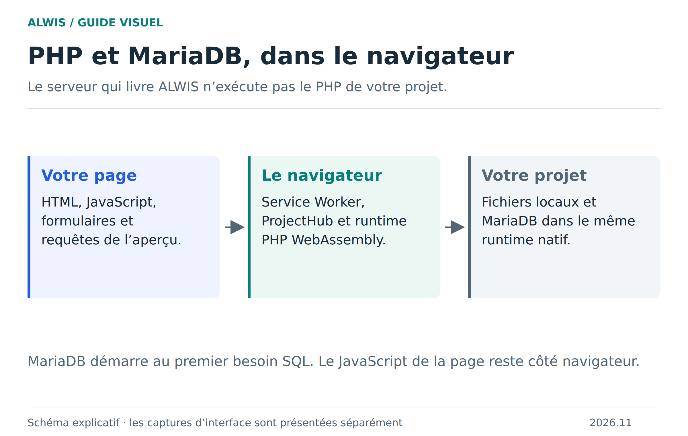

# Comprendre ALWIS avant de commencer

ALWIS réunit un éditeur de code, un aperçu web et des outils de base de données. Son intérêt est de rendre visible toute la chaîne : vous changez un fichier PHP, vous ouvrez la page, puis vous regardez les données que cette page a lues ou modifiées.

## Le studio, le projet et le visiteur

Le **studio** est l’outil ALWIS. Le **projet** contient vos fichiers et vos bases SQL. Le **visiteur** est une identité de navigation utilisée pour consulter votre site : ses cookies et sa session PHP lui appartiennent.

Deux visiteurs peuvent donc voir des pages différentes dans le même projet. Par exemple, Camille ouvre l’administration du Campus et Alice consulte son espace élève. Ils utilisent la même base, mais pas la même session PHP. Ces profils sont fictifs et sans mot de passe ; ils servent à apprendre, pas à fournir une authentification sécurisée.

[Schéma SVG téléchargeable](figures/sessions.svg)

## Où s’exécutent PHP et MariaDB ?

Dans votre navigateur, grâce à WebAssembly. Le serveur qui livre les fichiers du studio ne devient pas le serveur PHP de votre projet. MariaDB se lance quand une opération SQL le demande. Un projet sans SQL ne doit donc pas être confondu avec un projet qui a déjà démarré la base.

[Schéma SVG](figures/execution.svg) · [Détails d’architecture](architecture.md)

## Où reste votre travail ?

Le stockage du navigateur appartient à une origine web et à un profil de navigateur. Changer de navigateur ou d’adresse ne retrouve pas automatiquement vos projets. Effacer les données du site peut supprimer ce stockage. Le mode de navigation privée n’est pas un endroit durable pour travailler.

Enregistrer crée un point de reprise local. Exporter une archive crée une copie que vous pouvez ranger ailleurs et réimporter. Le dossier du PC constitue un autre mode de travail avec des permissions spécifiques : l’import d’un dossier est une copie, pas une synchronisation automatique.

## Un parcours simple

1. Ouvrez le Campus et repérez code, aperçu et données.
2. Modifiez une page et regardez le résultat.
3. Examinez une table avant de changer ses valeurs.
4. Essayez deux visiteurs pour distinguer session et base partagée.
5. Enregistrez puis exportez votre projet.

[Commencer la visite guidée](README.md) · [Bien sauvegarder](saving-projects.md) · [Tous les parcours](wiki-home.md)
