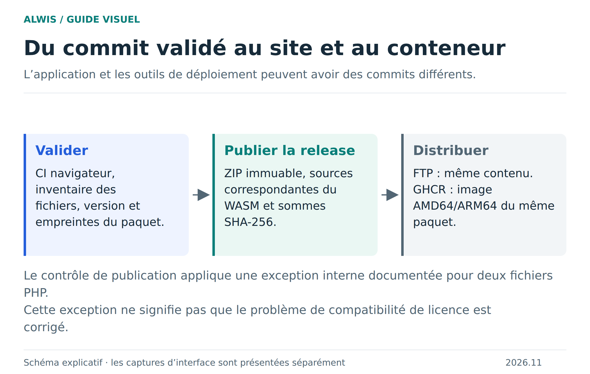

# Héberger, valider et publier ALWIS

Le ZIP statique et l’image Docker servent le même studio. PHP et MariaDB restent dans le navigateur du projet. Le serveur Docker ajoute les services de collaboration et les réglages d’administration ; sa base SQLite n’est pas la base des projets.



[Schéma SVG](figures/publication.svg) · [Vue d’ensemble du serveur](server-deployment.md)

## Déployer l’édition serveur avec Docker Compose

Le Compose recommandé est réduit à l’image, l’URL publique et au mot de passe d’administration. Il utilise `latest` et garde les tags numérotés disponibles dans [GitHub Packages](https://github.com/Bastian-Noel/ALWIS/pkgs/container/alwis-server) pour figer une version. Le port hôte et le dossier de données ont des valeurs par défaut.

Le fichier [`server/compose.yaml`](../server/compose.yaml) :

```yaml
services:
  alwis:
    image: ${ALWIS_SERVER_IMAGE:-ghcr.io/bastian-noel/alwis-server:latest}
    init: true
    restart: unless-stopped
    read_only: true
    cap_drop: [ALL]
    security_opt:
      - no-new-privileges:true
    user: "10001:10001"
    environment:
      PUBLIC_BASE_URL: ${PUBLIC_BASE_URL:?Définissez PUBLIC_BASE_URL dans .env}
      TRUST_PROXY: ${TRUST_PROXY:-true}
      ALWIS_PREVIEW_ORIGIN: ${ALWIS_PREVIEW_ORIGIN:-}
      ALWIS_ADMIN_PASSWORD: ${ALWIS_ADMIN_PASSWORD:?Définissez ALWIS_ADMIN_PASSWORD dans .env}
    ports:
      - "127.0.0.1:${ALWIS_PORT:-3100}:3000"
    volumes:
      - ${ALWIS_DATA_DIR:-./data}:/data
    tmpfs:
      - /tmp:size=16m,uid=10001,gid=10001,mode=1770
    pids_limit: 128
    healthcheck:
      test: ["CMD", "node", "--disable-warning=ExperimentalWarning", "-e", "fetch('http://127.0.0.1:3000/readyz').then(r=>process.exit(r.ok?0:1)).catch(()=>process.exit(1))"]
      interval: 30s
      timeout: 5s
      retries: 3
      start_period: 15s
    stop_grace_period: 30s
    logging:
      driver: json-file
      options:
        max-size: "10m"
        max-file: "3"
```

Depuis une copie du dépôt, préparez le `.env` minimal :

```bash
cd server
cp .env.example .env
```

Il contient les deux valeurs à fournir :

```dotenv
PUBLIC_BASE_URL=https://alwis.example.org
ALWIS_ADMIN_PASSWORD=
```

Générez le mot de passe avec `openssl rand -hex 32`, collez la sortie dans `.env`, puis protégez le fichier avec `chmod 600 .env`. Compose passe le mot de passe directement dans `ALWIS_ADMIN_PASSWORD`; aucun fichier de mot de passe ni secret Docker n’est utilisé. Ne versionnez jamais `.env`. Les personnes ayant accès à l’hôte Docker peuvent lire l’environnement du conteneur avec `docker inspect`.

Le bind mount conserve SQLite dans `./data` à côté de `compose.yaml`, monté sous `/data` dans le conteneur. Préparez ses permissions pour l’utilisateur non-root :

```bash
mkdir -p data
sudo chown 10001:10001 data
```

Vérifiez la configuration puis démarrez et contrôlez le service :

```bash
docker compose config
docker compose pull
docker compose up -d
docker compose ps
docker compose logs --tail=100 alwis
```

Ouvrez `https://alwis.example.org/admin/server` derrière HTTPS. Le reverse proxy doit conserver les en-têtes COOP/COEP nécessaires à WebAssembly. Le port publié reste lié à `127.0.0.1`. Utilisez `docker compose logs -f --tail=100 alwis` pour diagnostiquer et `docker stats alwis` pour observer les ressources.

| Priorité | Variable | Type et valeur conseillée | Rôle |
|---|---|---|---|
| Obligatoire | `PUBLIC_BASE_URL` | URL HTTPS publique ; HTTP permis sur localhost | Adresse canonique de l’instance. Le Compose refuse de démarrer si elle n’est pas définie. |
| Obligatoire | `ALWIS_ADMIN_PASSWORD` | Au moins 20 octets ; `openssl rand -hex 32` produit 32 octets aléatoires | Mot de passe HTTP Basic de `/admin/server`, transmis directement dans l’environnement du conteneur. |
| Recommandée | `ALWIS_PORT` | Entier, `3100` par défaut | Port hôte auquel se connecte le reverse proxy. Le service n’écoute publiquement que sur la boucle locale; le port interne reste `3000`. |
| Recommandée | `ALWIS_DATA_DIR` | Dossier hôte, `./data` par défaut | Répertoire bind-mounté vers `/data` dans le conteneur. Il conserve la base SQLite des réglages; l’UID conteneur `10001` doit pouvoir y écrire. |
| Optionnelle | `ALWIS_SERVER_IMAGE` | `ghcr.io/bastian-noel/alwis-server:latest` par défaut | Permet de choisir un tag de version précis au lieu de `latest`. Les tags sont listés dans [GitHub Packages](https://github.com/Bastian-Noel/ALWIS/pkgs/container/alwis-server). |
| Optionnelle | `TRUST_PROXY` | Booléen, `true` dans ce Compose derrière le proxy local | Lit `X-Forwarded-Proto` pour reconnaître HTTPS après terminaison TLS. Mettez `false` si aucun proxy de confiance n’est utilisé. |
| Optionnelle | `ALLOWED_ORIGINS` | Origines HTTPS exactes, séparées par des virgules ; vide par défaut | À configurer seulement si l’interface et l’API sont servies depuis des origines différentes. L’origine de l’instance est déjà autorisée. |
| Optionnelle | `ALWIS_ADMIN_USER` | `admin` par défaut | Nom utilisé avec le mot de passe pour l’authentification d’administration. |
| Diagnostic | `ALWIS_LOG_LEVEL` | `info` par défaut ; `warn` ou `error` pour réduire le journal | Niveau initial des logs. Les changements enregistrés dans `/admin/server` sont ensuite conservés dans SQLite. Les commandes `docker compose logs` et `docker stats` servent au diagnostic. |
| Avancée | `PORT`, `HOST` | `3000` et `0.0.0.0` dans l’image | Port et interface internes du serveur. Gardez ces valeurs sauf si vous modifiez également le port publié et le healthcheck. |

`ALLOWED_ORIGINS`, `ALWIS_ADMIN_USER` et `ALWIS_LOG_LEVEL` ne figurent pas dans le Compose minimal : ajoutez-les sous `environment` uniquement si nécessaire. `ALWIS_DATA_DIR` désigne ici le chemin hôte du bind mount; l’application continue d’utiliser `/data` dans le conteneur. Le serveur accepte les niveaux `info`, `warn` et `error`, sans mode `debug` verbeux.


## Servir le paquet statique

Le ZIP publié se lance avec `node serve.mjs`, puis `http://127.0.0.1:8080` (Node.js 20+). Pour un hébergeur, conservez les chemins et le contenu de `release.json`. Le site doit être servi en HTTPS, ou sur localhost en développement, avec :

- `Cross-Origin-Opener-Policy: same-origin` ;
- `Cross-Origin-Embedder-Policy: require-corp` ;
- WASM en `application/wasm` et JavaScript avec un type MIME correct ;
- un Service Worker autorisé, sans réécrire tous les fichiers manquants vers `index.html`.

Apache peut appliquer le bloc `.htaccess` fourni. Nginx doit recevoir sa propre configuration équivalente. L’outil d’export SQL est distribué comme `sql-export.source.txt` : il n’a pas à être exécuté en PHP par l’hébergeur.

## Sept workflows, des responsabilités séparées

| Numéro | Workflow | Rôle |
|---|---|---|
| 01 | Sources | Contrôles rapides des sources et politiques |
| 02 | WASM | Reconstruction native épinglée et validations navigateur |
| 03 | Studio | Build et parcours du paquet applicatif |
| 04 | HTTP invité | Tests dédiés de l’aperçu invité |
| 05 | Wiki | Génération et publication de la documentation |
| 06 | FTP | Publication manuelle d’un paquet déjà validé |
| 07 | Conteneur | Publication de l’image issue de ce paquet statique |

Les définitions sont dans [.github/workflows](../.github/workflows). Les dépendances navigateur utilisent une action et un cache partagés ; npm, les bundles et les archives natives ont des identités de cache distinctes. Un cache accélère, mais ne prouve pas qu’un test a réussi.

## Publier avec 06 — FTP

Dans Actions, ouvrez **06 - Publication - FTP**, choisissez `main` et renseignez `version`. Le champ `source_sha` permet de sélectionner une révision applicative déjà validée, même si les outils de publication ont changé depuis. Il ne permet pas de publier arbitrairement des sources non testées.

Le workflow vérifie la politique de licence/version, récupère le paquet exact d’une CI réussie, contrôle ses empreintes puis crée ou réutilise la release correspondante. Une release existante doit conserver les mêmes sources et le même contenu : ses sommes puis chaque fichier décompressé sont comparés. Il n’est pas permis de remplacer une version publiée par un autre build.

Pour FTP, configurez le secret `FTP_PASSWORD` et les variables `FTP_REMOTE_DIR` et `FTP_PUBLIC_URL` selon l’hébergement. Aucun secret ne doit figurer dans les sources. L’inventaire statique impose un manifeste exact et des plafonds de fichiers/volume ; il ne publie pas de script PHP exécutable côté serveur.

Le transfert prépare les fichiers avant promotion, envoie les ressources immuables sous `/_alwis/<révision>/`, puis l’index et `release.json`. La promotion est atomique par fichier, pas transactionnelle sur tout le site. Le contrôle de l’URL publique vérifie TLS et les en-têtes lorsqu’elle est configurée. Une release créée avant un échec FTP ne démontre pas la réussite du transfert : vérifiez la fin du job.

## Publier avec 07 — Conteneur

Après un succès du workflow 06, le workflow 07 récupère le paquet statique validé et son artefact d’identité `studio-static-source`. Il construit à partir de la **révision applicative** contenue dans cet artefact, qui peut différer du commit des outils de déploiement.

Pour une relance manuelle, renseignez `static_run_id` et `source_sha` correspondant à cette publication. L’image est publiée dans GHCR pour AMD64 et ARM64. Le champ `image_version` sert au retagage d’une version déjà publiée selon le chemin dédié du workflow.

La publication de l’image et le redémarrage d’une instance sont deux actions distinctes. Pour mettre à jour votre hôte, contrôlez le tag choisi, récupérez l’image puis recréez le service avec Compose. Conservez une sauvegarde des réglages sous `/data` ; les projets des utilisateurs restent dans leurs navigateurs.

## Version publiée et traçabilité

La [release 2026.11 Beta 1](https://github.com/Bastian-Noel/ALWIS/releases/tag/v2026.11.0-beta.1) correspond à la révision applicative `be76a72a2067a8ba792089a529d0e52e43cf9e78`. Elle contient le ZIP du studio, les reçus de validation, les sources correspondantes du WASM et les sommes SHA-256. [FTP validé](https://github.com/Bastian-Noel/ALWIS/actions/runs/42938200622) · [Conteneur publié](https://github.com/Bastian-Noel/ALWIS/actions/runs/42940278432).

Les contrôles de licence appliquent l’exception interne de cette bêta aux deux fichiers historiques PHP précisément identifiés. Ils ne retirent pas les notices et n’accordent aucun droit de tiers supplémentaire. [État de publication](../provenance/release-licensing-status.json) · [Politique exécutable](../scripts/publication_policy.py).

Les artefacts Actions ont une durée de rétention limitée. Les pièces jointes de release sont la distribution durable ; les sources et notices de provenance doivent être conservées. [Preuves de validation](runtime-parity.md) · [Compilation WASM](native-qa-build.md).
