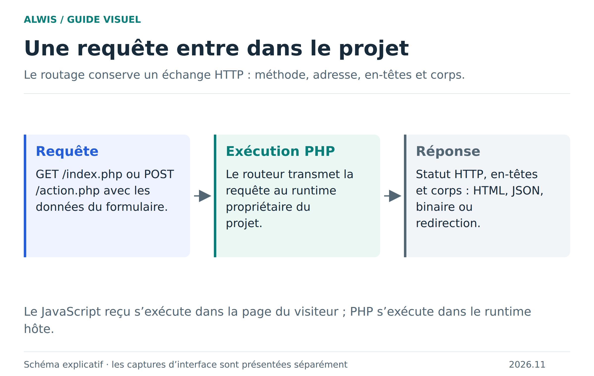

# HTTP et cURL : capacités et limites du navigateur

Les flux HTTP PHP et le sous-ensemble cURL reposent sur Fetch, Asyncify et l’adaptateur HTTP du runtime. Sept cas navigateur ont été validés dans Chromium et Firefox avec le build indépendant : il s’agit d’une compatibilité testée sur ces scénarios, pas d’une implémentation complète de libcurl.

## Fonctions prises en charge

Les flux PHP permettent notamment `file_get_contents` en HTTP(S), les méthodes et en-têtes personnalisés, les corps binaires, `ignore_errors`, les redirections et les délais, sous réserve des règles du navigateur.

Le sous-ensemble cURL expose `curl_init`, `curl_setopt`, `curl_setopt_array`, `curl_exec`, `curl_errno`, `curl_error`, `curl_getinfo`, `curl_close`, `curl_reset`, `curl_copy_handle`, `curl_escape`, `curl_unescape` et `curl_version`. Les options courantes comprennent URL, RETURNTRANSFER, POST, POSTFIELDS, HTTPHEADER, CUSTOMREQUEST, USERAGENT, TIMEOUT, TIMEOUT_MS, HEADER, NOBODY, HTTPGET, FAILONERROR et FOLLOWLOCATION.

Les options inconnues renvoient `false`. L’objet `CurlHandle` est un objet de compatibilité PHP lorsque l’extension native n’est pas présente ; son identité de classe n’équivaut pas à celle de libcurl amont.

## Des limites distinctes

| Limite | Valeur | Interprétation |
|---|---:|---|
| Corps de requête | 8 Mio | Volume maximal envoyé par cet adaptateur |
| Réponse | 16 Mio | Volume maximal reçu, pas une autorisation de charger arbitrairement la RAM |
| Attente Fetch | 180 secondes au maximum | Plafond d’une attente réseau ; une limite plus courte peut être demandée |

Les nombres et longueurs d’en-têtes sont aussi bornés. `NativeRuntime.abortHttp()` annule le Fetch courant depuis la boucle du worker ; il n’interrompt pas un calcul PHP purement CPU ni une requête SQL en cours.

Les redirections exigent explicitement `CURLOPT_FOLLOWLOCATION`. Sans cette option, Fetch les refuse. Le navigateur peut masquer des informations de réponse lors de redirections ou refuser un accès CORS/TLS ; PHP ne contourne pas ces restrictions.

## Appeler son propre site

Le worker exécute un seul script PHP à la fois. Attendre une autre page PHP du même moteur reviendrait à attendre une tâche placée derrière soi dans la file. Pour éviter ce blocage :

1. Les GET vers des fichiers statiques locaux existants lisent directement le contenu du projet.
2. Les routes PHP dynamiques locales et les méthodes autres que GET sont refusées avec une erreur explicite, même si une réécriture cache l’extension `.php`.
3. Les autres destinations HTTP(S) utilisent Fetch, avec CORS et TLS.

## Ce qui n’est pas fourni

Pas de `curl_multi`, sockets brutes, proxy CONNECT, TLS personnalisé, cookie jar complet ou uploads multipart via `CURLFile`. Pour un formulaire envoyé par une page à son projet, utilisez l’aperçu HTTP normal : ce n’est pas la même opération qu’un appel sortant depuis PHP.

Les fixtures sont [native-curl.php](../fixtures/compatibility/native-curl.php) et le [test navigateur](../tests/browser/native-curl.mjs). [Preuves de validation](runtime-parity.md) · [Trajet HTTP](http-runtime.md) · [Dépannage](troubleshooting.md).
