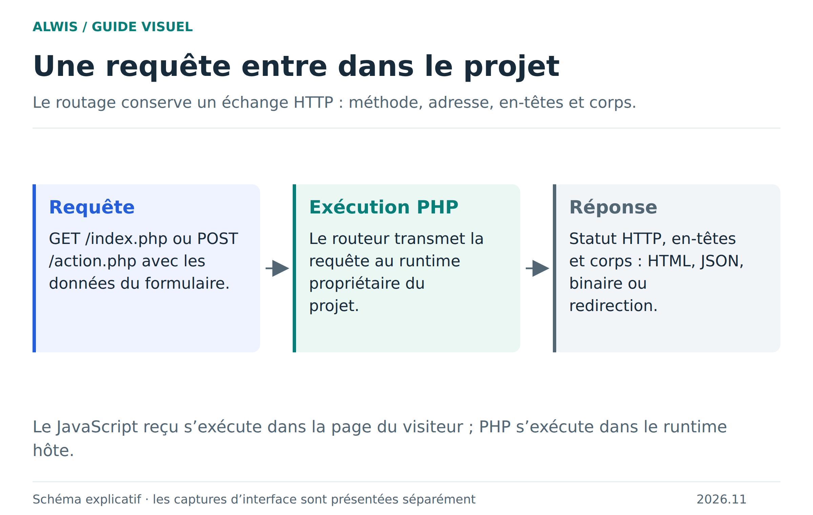
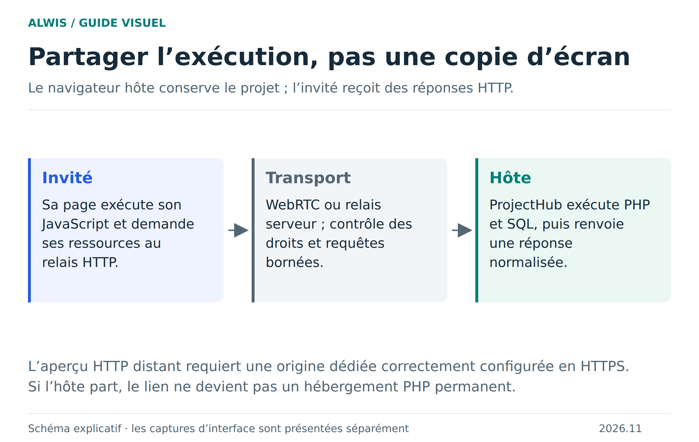

# Du clic à PHP : le trajet d’une requête HTTP

Dans l’aperçu, un lien, un formulaire ou un appel JavaScript produit une requête web. ALWIS la transforme en opération du projet, l’exécute et reconstruit une réponse HTTP : statut, en-têtes et corps. Cette chaîne permet de tester une application PHP sans serveur PHP installé sur le PC.



[Version SVG](figures/http.svg)

## Le chemin local

Le Service Worker intercepte les routes de l’aperçu. Le ProjectHub organise l’accès au projet et transmet le travail au runtime. Les fichiers statiques peuvent être servis depuis les fichiers du projet ; les scripts PHP passent par la SAPI du moteur WASM. PHP peut accéder à MariaDB embarqué via PDO ou MySQLi.

Les cookies, le chemin, la méthode et le corps font partie de la requête. Une requête POST ne doit pas être rejouée comme un simple rafraîchissement GET. Un fichier binaire ne doit pas passer par un décodage texte qui modifierait ses octets. C’est pourquoi les tests ne vérifient pas seulement une page HTML : ils vérifient aussi les méthodes, les sessions et les ressources.

## Un petit endpoint de diagnostic

Créez `echo.php` dans un projet de test :

```php
<?php
header('Content-Type: application/json; charset=utf-8');
echo json_encode([
    'method' => $_SERVER['REQUEST_METHOD'],
    'input' => file_get_contents('php://input'),
    'form' => $_POST,
], JSON_UNESCAPED_UNICODE);
```

Depuis une page du même aperçu :

```js
const response = await fetch('/echo.php', {
  method: 'POST',
  headers: { 'Content-Type': 'application/json' },
  body: JSON.stringify({ message: 'Bonjour' })
});
console.log(response.status, await response.json());
```

Un corps JSON se lit dans `php://input` : il ne remplit pas automatiquement `$_POST` comme un formulaire encodé. Pour un upload, utilisez les mécanismes de formulaire adaptés et vérifiez le type reçu avant de traiter le fichier.

## Plusieurs visiteurs

Les visiteurs locaux ont des cookies et sessions PHP séparés, avec une base commune. Les invités distants empruntent un chemin plus long : leur aperçu sur une origine dédiée transmet la requête à l’hôte. Celui-ci applique les droits, exécute et renvoie la réponse.



[Version SVG](figures/collaboration.svg) · [Configuration et limites de collaboration](collaboration.md)

Cette origine séparée protège le studio des scripts de la page invitée. Elle doit être configurée avec HTTPS. Sans elle, l’aperçu interactif invité n’est pas activé ; un mode de compatibilité peut fournir des instantanés sans exécuter les scripts.

## Quand PHP appelle un service externe

Les flux HTTP PHP et le sous-ensemble cURL utilisent **Fetch du navigateur**, avec Asyncify pour attendre la réponse. Ils restent soumis à CORS et TLS. Ce n’est pas une connexion TCP libre à n’importe quel service.

Le worker n’exécute qu’un script PHP à la fois. Un script qui attendrait une autre page PHP du même moteur bloquerait sa propre file : ces sous-requêtes dynamiques sont refusées. Les GET de ressources statiques locales suivent un chemin direct. [Options, volumes et limitations HTTP/cURL](http-compatibility.md).

[Architecture](architecture.md) · [Erreurs et récupération](php-error-recovery.md) · [Dépannage](troubleshooting.md)
