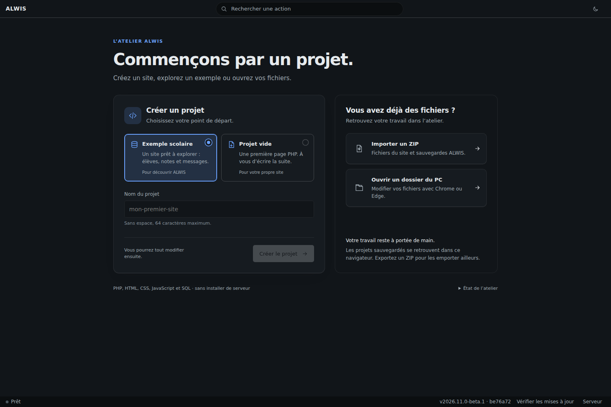
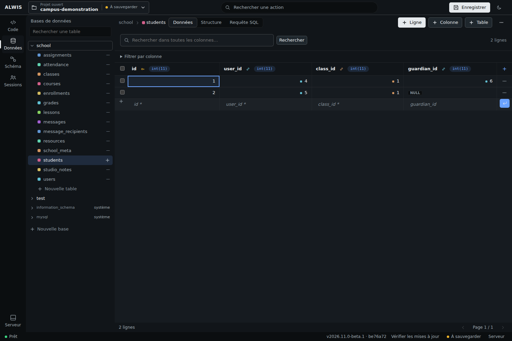
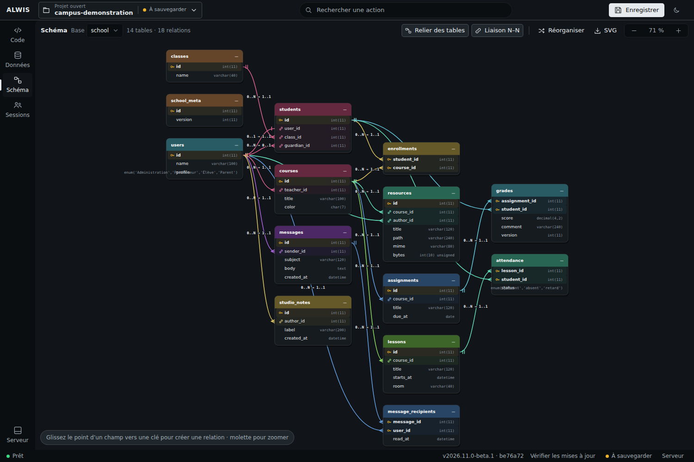

# Illustrations : captures, schémas et exports

Le wiki combine des captures réelles et des schémas pédagogiques. Les premières montrent le produit ; les seconds isolent une notion pour l’expliquer. Les données du Campus et de la table de valeurs sont fictives.

## Captures du studio publié

Les douze captures de cette refonte ont été produites dans un contexte navigateur jetable depuis `https://studio.mmi.place/`, sur le paquet applicatif `be76a72a2067a8ba792089a529d0e52e43cf9e78`. Le [registre de capture](images/capture-metadata.json) précise leur origine et les dimensions. Les vues de travail utilisent 1500 × 1000 pixels ; l’accueil mobile utilise 390 × 844 pixels.

Le [script de capture](../scripts/capture-doc-screens.mjs) ouvre une copie locale du Campus, change les vues et les thèmes, puis crée une table pédagogique pour illustrer les valeurs. Il n’édite aucun projet distant. Il dépend de la version d’interface ciblée ; relisez ses sélecteurs lors d’une future mise à jour.

## Planches explicatives

Les 19 planches sont dessinées en SVG, avec du texte sélectionnable, une palette commune et des titres lisibles. Leurs exports PNG font **2400 × 1520 pixels**, soit deux fois le canevas de conception. Le PNG est adapté à l’affichage GitHub Wiki ; le SVG permet une reprise ou un export vectoriel.

Les bandes des grands entiers indiquent des plages, pas une échelle proportionnelle. Les schémas de stockage et mémoire décrivent des périmètres, pas des résultats de benchmark. Les chiffres des mesures historiques restent dans leur rapport daté.

Pour régénérer les planches :

```sh
python3 scripts/build-doc-figures.py
node scripts/render-doc-figures.mjs
```

Le rendu utilise Playwright déjà installé sous `build-work/php/node_modules/` et Chromium. Le script vérifie que le texte reste dans le canevas ; la vérification visuelle reste nécessaire pour les espacements et les liens. La [publication du wiki](wiki-publication.md) copie les PNG et SVG référencés sans dépendre d’un service de diagrammes distant.

Les conditions de la documentation et des visuels figurent dans [LICENSE.md](../LICENSE.md). Les logos et composants tiers conservent leurs propres droits.

## Galerie : les mêmes outils en thème sombre

Le thème change le confort de lecture, pas la signification des données ni le fonctionnement du schéma.






