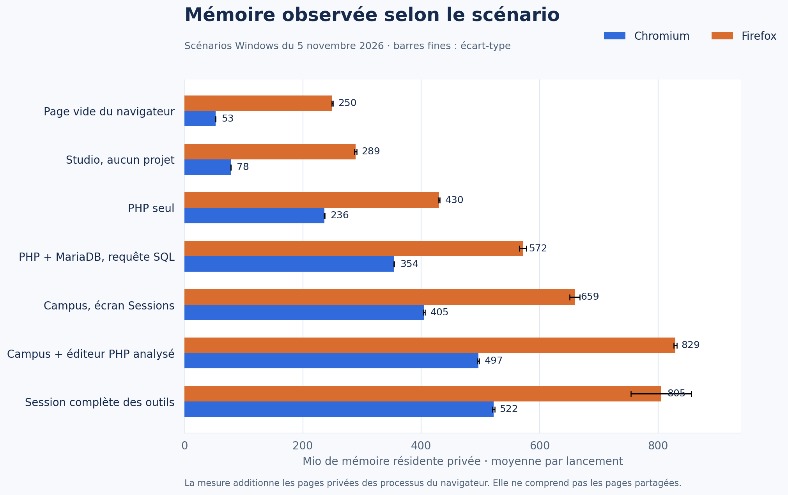
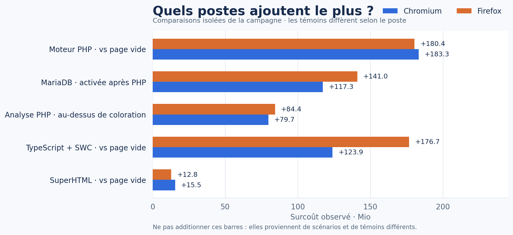

# Mémoire et performances, en bref

**Pour comprendre l’ordre de grandeur**, comparez d’abord des scénarios complets. Les mesures viennent d’un test Windows du 5 novembre 2026 ; ce n’est pas une promesse de consommation sur chaque ordinateur.

[Lire la méthode et toutes les mesures](performance.md) · [Découvrir le fonctionnement](../README.md)

## Ce qu’on observe

| Scénario mesuré | Chromium | Firefox |
|---|---:|---:|
| PHP seul | 236 Mio | 430 Mio |
| PHP avec MariaDB initialisée | 354 Mio | 572 Mio |
| Campus avec éditeur PHP et analyse | 497 Mio | 829 Mio |
| Studio sans projet | 79 Mio | 289 Mio |

La mémoire varie aussi avec le navigateur : Firefox consommait déjà davantage sur la page vide de ce test. Les valeurs d’ALWIS ne s’obtiennent donc pas en comparant les deux colonnes sans leur témoin.

## À retenir

- **Sans SQL, MariaDB ne démarre pas.** Aucun Worker SQL ni fichier de base n’a été observé dans le scénario PHP seul.
- **L’analyse du code a un coût mesurable.** La coloration PHP seule est plus légère que PHP avec analyse ; TypeScript/SWC est aussi un poste important dans ce test.
- **Masquer un outil ne suffit pas toujours à libérer sa mémoire.** Arrêter le service PHP de l’éditeur a eu un effet visible, mais variable ; retirer son DOM ensuite a presque rien changé.
- **Les valeurs de WASM, VFS et RAM du navigateur sont différentes.** On ne les additionne pas.

Les barres du second graphique utilisent des témoins différents : **ne les additionnez pas**. La campagne avait seulement deux ou trois répétitions par scénario et s’est arrêtée avant les cinq prévues.

### Voir les résultats complets

Le [rapport complet](performance.md) contient toutes les configurations, les écarts par outil, les tests de déchargement, les détails WASM/VFS et le protocole.
