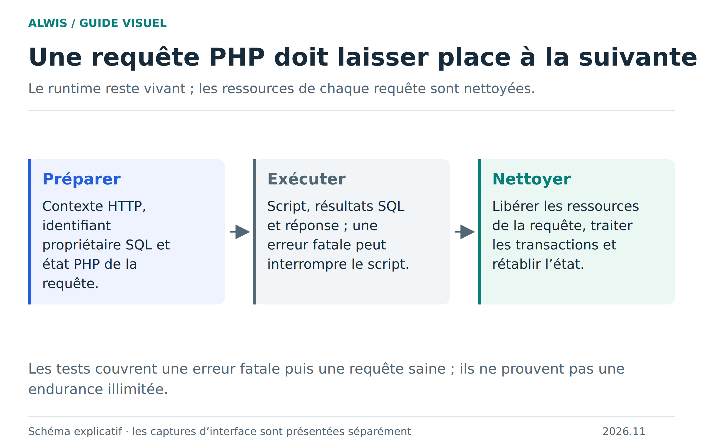

# Erreurs PHP : nettoyer une requête et repartir correctement

Un moteur WASM reste vivant entre plusieurs requêtes. Il faut donc que la fin d’une page, même en erreur, ne transmette pas son statut, ses connexions ou sa transaction abandonnée à la page suivante. La bêta vérifie ce comportement avec **18 requêtes successives par navigateur**, dans Chromium et Firefox.

[Version SVG](figures/cycle-php.svg)

## Ce que voit l’utilisateur

Une exception non capturée ou une erreur fatale appartient à la requête qui l’a produite. Une requête suivante correcte doit pouvoir renvoyer HTTP 200 avec son propre résultat. Un `exit(42)` ne doit pas imposer ce code de sortie aux requêtes suivantes. Un statut volontaire 429 doit aussi rester local à sa réponse.

La récupération ne signifie pas que tous les effets ont disparu. Les connexions et transactions SQL abandonnées sont nettoyées ; les écritures PHP déjà effectuées dans les fichiers ne sont pas annulées par ce nettoyage. [Transactions et limites d’atomicité](sql-transactions.md).

## Deux états natifs à remettre à zéro

Le runner réinitialise `EG(exit_status)` après un `php_request_startup()` réussi, avant l’exécution du code utilisateur. Il réinitialise aussi `SG(sapi_headers).http_response_code` à 200 avant le démarrage de la requête suivante. Ces deux états sont indépendants : un code de sortie réparé ne suffit pas si le statut HTTP reste 500.

`SG(server_context)` reste valide jusqu’à `php_request_shutdown()` pour que POST, `php://input` et les cookies soient correctement traités ; il est nettoyé ensuite. Le nettoyage SQL libère connexions et statements et annule les transactions laissées ouvertes.

## Quand le moteur doit être refusé

Un échec de démarrage, un bailout échappant à l’exécuteur ou un échec de shutdown peut rendre le moteur non réutilisable. `php_wasm_reusable()` l’expose au worker, qui refuse de poursuivre dans un état déclaré dangereux. Une ABI incomplète ne doit pas provoquer un repli silencieux sur un ancien binaire.

La mémoire PHP est également couverte : le patch Emscripten des chunks Zend évite les libérations partielles incompatibles avec le modèle mémoire, tout en conservant `memory_limit`. Le plafond du tas WASM et la limite PHP ne désignent pas la même chose. [Lire les niveaux de mémoire](performance-summary.md).

## Vérification et diagnostic

Le [test navigateur](../tests/browser/native-error-recovery.mjs) exerce notamment exception non capturée, ParseError, PDOException en transaction, sortie non nulle, statut explicite et dépassement de mémoire, chacun suivi de requêtes de contrôle. Les résultats inspectent statut HTTP, code de sortie, corps et ressources SQL résiduelles.

Les correctifs sont dans le [runner PHP](../packages/php-native/src/runner.c) et le [patch mémoire](../engine/patches/php-8.4.27-wasm-chunks.patch). Les reçus sont produits sous `build-work/native-recovery/` ; la [page de parité](runtime-parity.md) identifie le build validé. Pour une erreur de votre application, commencez par le [dépannage](troubleshooting.md).
