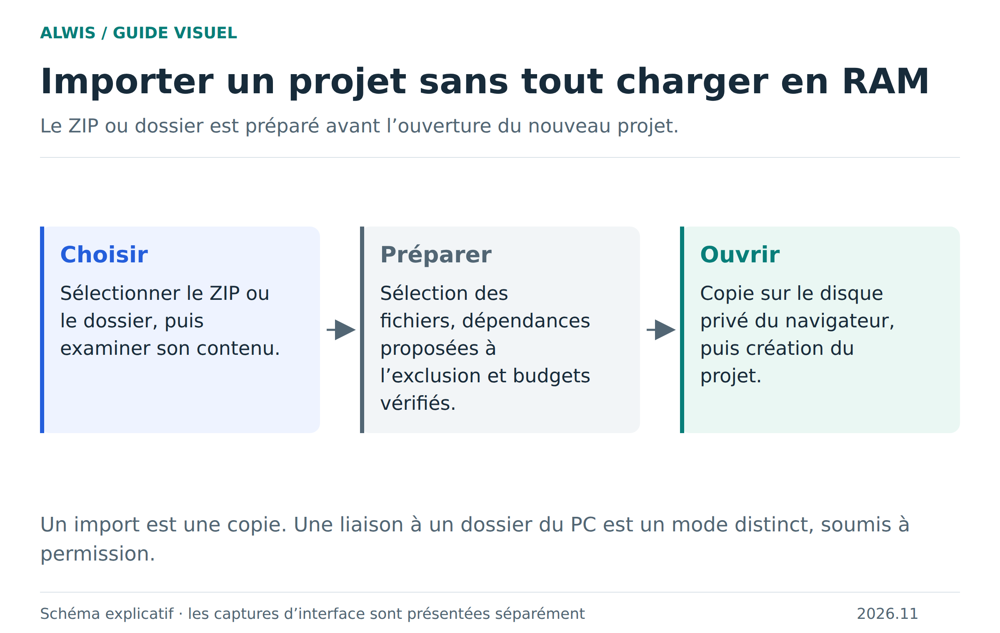
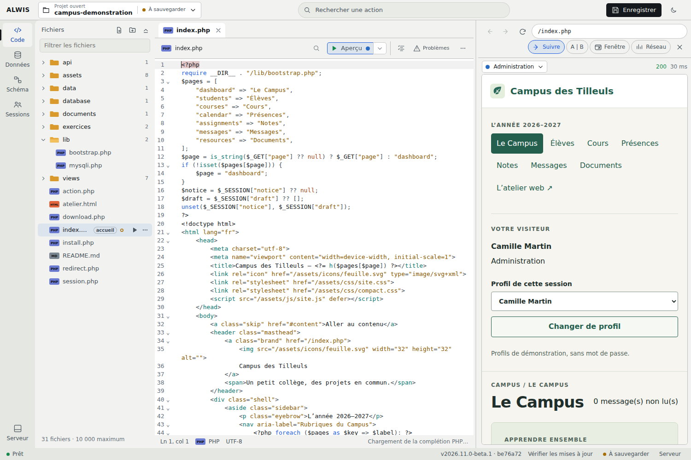

# Créer, importer et sauvegarder un projet

Un projet rassemble ses fichiers et ses bases. Choisissez votre mode de départ selon la copie que vous voulez modifier : créer dans le navigateur, importer une archive ou ouvrir un dossier du PC avec permission.

Un import de dossier ne synchronise pas automatiquement les changements ultérieurs du PC. La base SQL reste dans le navigateur, y compris lorsque les fichiers texte sont écrits dans un dossier local. [Import : schéma SVG](figures/import.svg) · [Sauvegarde et restauration](saving-projects.md).

[Accueil Wiki](https://github.com/Bastian-Noel/ALWIS/wiki) · [Premiers pas](README.md) · [Code](ide-workflows.md) · [Limites de stockage](storage-opfs.md)

## Créer un projet

1. Ouvrez [le studio ALWIS](https://studio.mmi.place/) ou lancez le paquet local.
2. Donnez un nom au projet.
3. Choisissez **Exemple scolaire** pour commencer avec un site et des tables déjà remplis, ou partez d’un projet vide.

## Importer un ZIP

1. Sur l’accueil, choisissez **Importer un ZIP**.
2. Sélectionnez les fichiers à garder dans l’écran de préparation.
3. Vérifiez la sélection, puis créez le projet.

Les dépendances comme `node_modules`, `vendor` et les caches sont proposées à l’exclusion. `composer.json` et `composer.lock` restent inclus. Vous pouvez réinclure une dépendance nécessaire avant de confirmer.

## Ouvrir un dossier du PC

**Ordinateur avec Chrome ou Edge.** Choisissez **Ouvrir un dossier du PC…**, sélectionnez le dossier et autorisez l’accès. Les fichiers texte enregistrés sont écrits dans le dossier ; la base SQL reste dans le stockage du navigateur.

## Enregistrer ou déplacer le projet

| Action | Résultat |
|---|---|
| **Enregistrer** ou **Ctrl + S** | Garde fichiers, bases et brouillons dans ce navigateur |
| **Exporter ZIP** | Télécharge une copie transportable des fichiers et des bases |
| **Rouvrir un dossier PC** | Reconnecte les fichiers du PC dans Chrome ou Edge |

Avant de changer de navigateur ou d’ordinateur, exportez un ZIP. Les sessions visiteurs et leurs cookies ne sont pas inclus dans cette copie.

[Voir les limites et exclusions détaillées](storage-opfs.md) · [Parcours du Campus](school-example.md)
