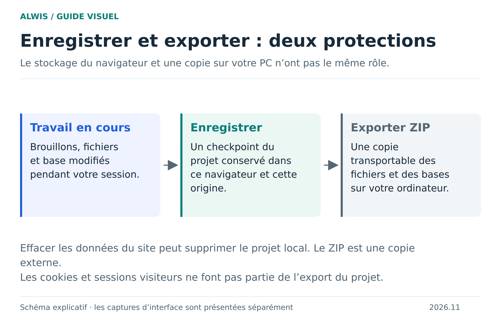
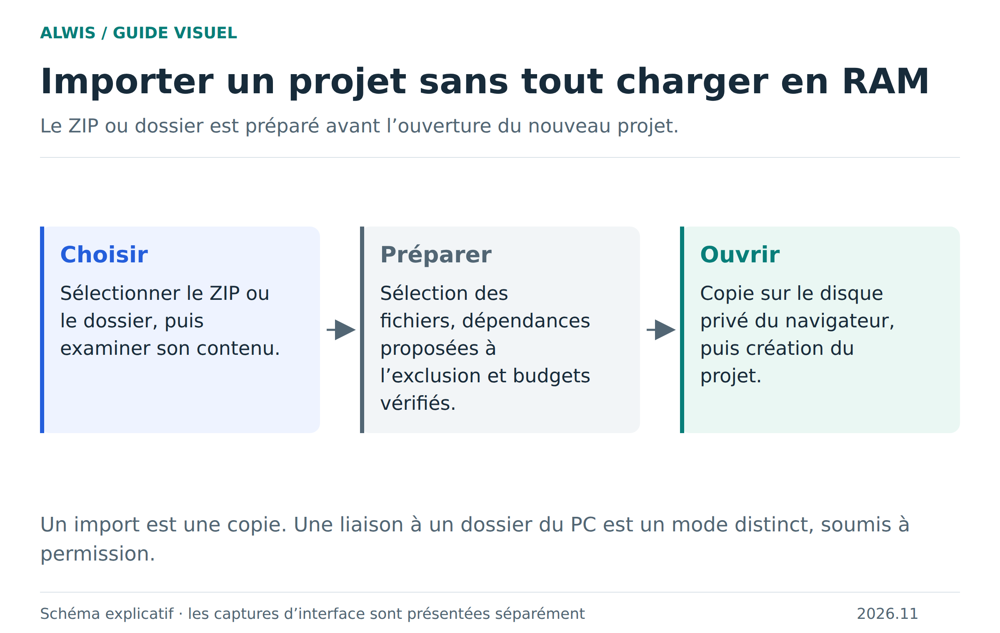

# Bien sauvegarder et retrouver un projet

Vous voulez pouvoir fermer le studio, revenir à votre projet et conserver une copie ailleurs. Ces trois intentions passent par des gestes différents : terminer une opération SQL, enregistrer le projet et exporter une archive.

[Version SVG](figures/sauvegarde.svg)

## Enregistrer dans le navigateur

**Enregistrer** crée un point de reprise du projet : fichiers et bases SQL sont réunis dans le mécanisme de sauvegarde. Attendez le succès de l’opération avant de fermer. Le catalogue conserve des générations cohérentes ; après une interruption, la reprise doit utiliser une génération validée plutôt qu’un mélange de fichiers et de base provenant de moments différents.

Cette sauvegarde dépend du site et du profil de navigateur. Un autre navigateur, une autre origine ou l’effacement des données du site ne retrouvent pas automatiquement vos projets. Les quotas et la politique d’éviction du navigateur s’appliquent. Un message d’échec signifie que vous ne devez pas considérer le dernier état comme durable.

## Exporter une copie indépendante

**Exporter ZIP** produit une archive des fichiers et des bases du projet. Téléchargez-la effectivement, puis rangez-la sur un support que vous contrôlez. Les sessions privées des visiteurs ne sont pas emportées : le ZIP transporte le projet, pas les connexions de ses utilisateurs de test.

Une bonne vérification consiste à réimporter ce ZIP sous un autre nom et à contrôler un fichier modifié ainsi qu’une valeur SQL. Le simple fait qu’un fichier porte l’extension `.zip` ne démontre pas que votre dernier changement est dedans.

## Importer n’est pas synchroniser

[Version SVG](figures/import.svg)

Un import ZIP ou dossier copie des contenus dans le projet. Modifier ensuite le fichier d’origine sur le PC ne modifie pas automatiquement cette copie. Le mode **dossier local** peut, avec permission, écrire certains fichiers du projet sur le PC ; la base SQL reste gérée par ALWIS dans le navigateur. Consultez le [guide des projets](project-workflows.md) pour choisir le bon mode.

## Après un arrêt brutal

Rouvrez le projet et contrôlez la dernière sauvegarde réussie. Un changement effectué après ce point peut manquer. Évitez de remplacer immédiatement votre seule archive par cet état : gardez les anciennes copies tant que vous n’avez pas vérifié les fichiers et les données.

Une transaction SQL validée par `COMMIT` n’est pas à elle seule une sauvegarde durable de tout le projet. Inversement, annuler une transaction ne supprime pas des fichiers PHP déjà écrits. [Comprendre les transactions](sql-transactions.md).

## Une routine raisonnable

Enregistrez après une étape cohérente. Exportez avant une transformation de structure ou une grosse importation. Conservez plusieurs archives datées hors du navigateur. Testez une restauration avant de dépendre de cette copie pour un travail important.

[Stockage, quotas et limites détaillées](storage-opfs.md) · [Dépannage](troubleshooting.md) · [Premiers pas](README.md)
