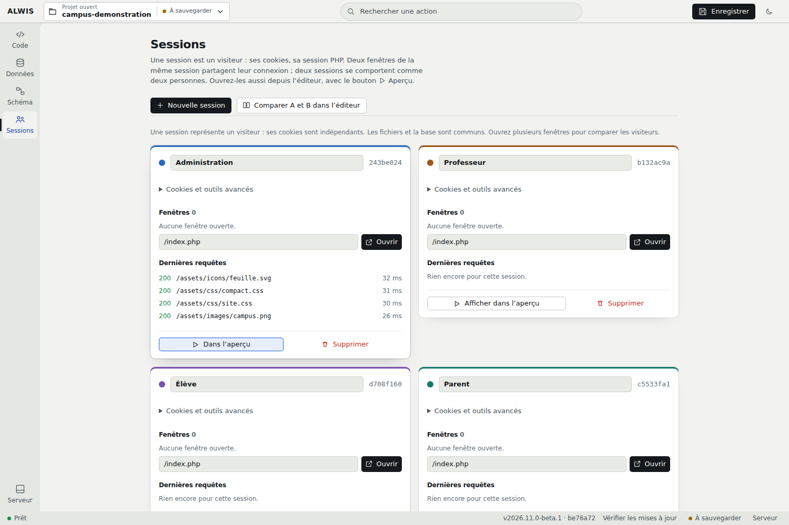
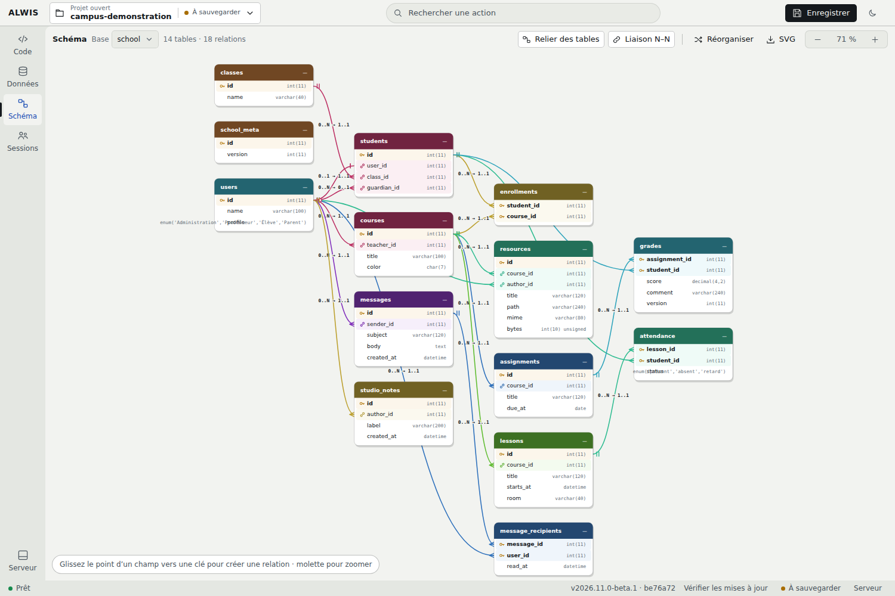
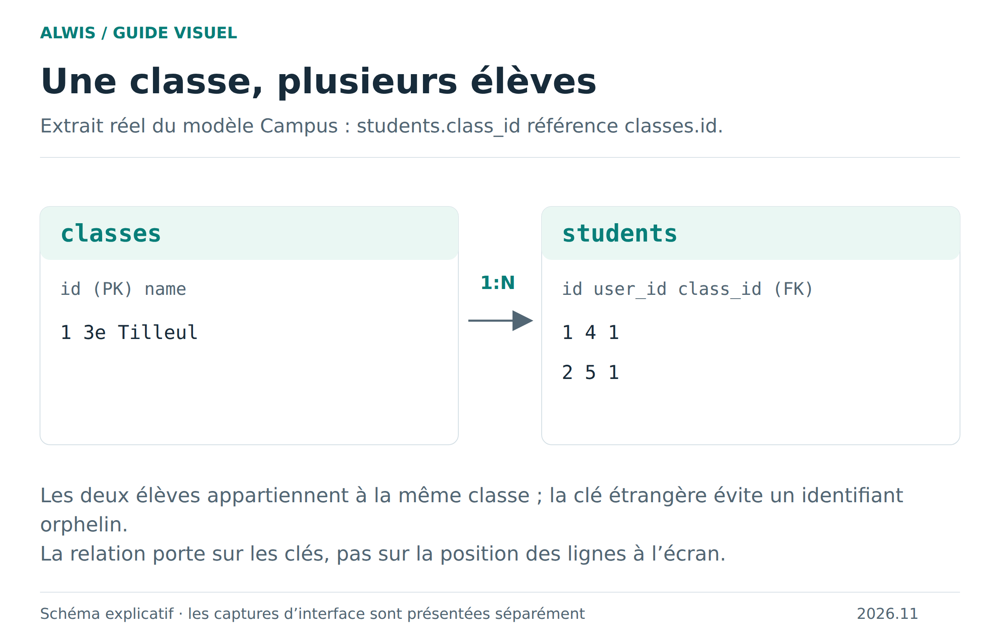
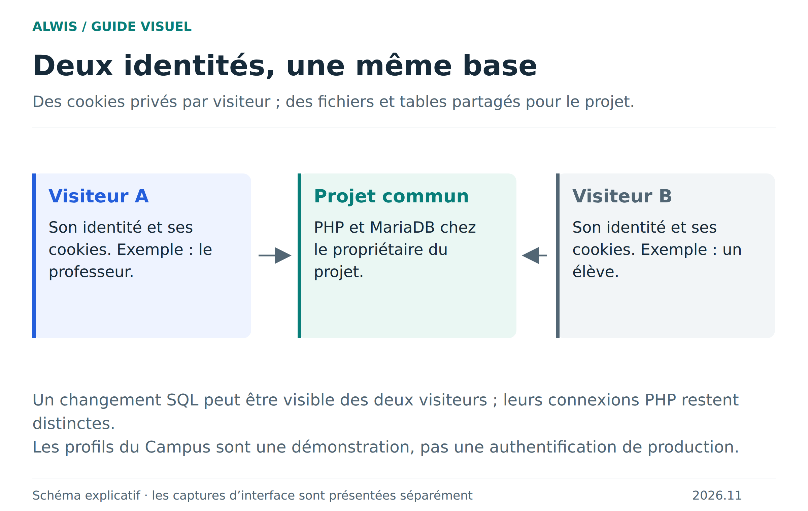

# Essayer le Campus des Tilleuls

[Accueil Wiki](https://github.com/Bastian-Noel/ALWIS/wiki) · [Créer ou importer un projet](project-workflows.md) · [SQL et relations](sql-workflows.md)

[← Guide illustré](README.md)

Le nouvel exemple contient **14 tables, 18 clés étrangères, 31 fichiers et quatre sessions**. Chaque table sert à un parcours du site. Les anciens projets restent intacts : créez un **nouveau projet → Exemple scolaire** pour l’essayer.

## Un Campus à plusieurs visiteurs

| Session | Profil initial |
|---|---|
| Administration | Camille Martin |
| Professeur | Nora Bernard |
| Élève | Alice Dupont |
| Parent | Emma Dupont |

Les fenêtres d’une même session partagent leurs cookies ; les sessions différentes gardent leur identité. Les six profils sont librement sélectionnables pour expérimenter : il ne s’agit pas d’une authentification de production.

## Parcours à essayer

- **Le Campus** : ajoutez une note au carnet commun et retrouvez-la depuis une autre session.
- **Élèves** : recherchez un prénom avec le filtre JavaScript. Les responsables facultatifs montrent la différence entre une valeur et `NULL`.
- **Cours** : ouvrez leurs documents et retrouvez les inscriptions N:N dans Schéma.
- **Présences** : le professeur met à jour une présence avec **MySQLi natif**, préparations et paramètres. Un élève peut consulter, mais le serveur refuse sa modification.
- **Notes** : choisissez un élève puis chargez sa note. Une valeur vide devient `NULL` ; les décimales sont envoyées comme chaînes à MariaDB. Ouvrez la même note dans deux sessions de l’équipe pédagogique : la deuxième modification périmée est refusée, en gardant la saisie et l’élève sélectionné.
- **Messages** : une transaction PDO crée le message et son destinataire. Un destinataire inexistant annule l’ensemble et garde le brouillon.
- **Documents** : envoyez un TXT, CSV, PNG ou JPEG de 512 Kio maximum. Le fichier rejoint `uploads/documents`, ses métadonnées sont dans MariaDB et sa lecture passe par le serveur statique du projet.
- **L’atelier web** : une page HTML autonome, un programme JavaScript et des images PNG/SVG. Le bilan des messages utilise `fetch` vers une API PHP/MySQLi ; observez sa requête et sa réponse dans Réseau.

## Explorer les fichiers

| Dossier ou fichier | Contenu |
|---|---|
| `index.php`, `action.php` | Page principale et traitements de formulaires : CSRF, validation, droits, redirection après POST |
| `views/`, `lib/`, `api/` | PHP lisible et mis en forme ; PDO et MySQLi ; API JSON |
| `assets/css/site.css`, `assets/js/site.js` | Styles et JavaScript organisés |
| `exercices/a-formater.php`, `exercices/a-formater.js`, `assets/css/compact.css` | Fichiers valides volontairement compacts pour essayer **Formater** |
| `atelier.html` | HTML statique relié aux exercices et aux médias |
| `assets/icons/`, `assets/images/` | Trois SVG et deux PNG créés pour la démonstration, sans ressource distante |
| `database/schema.sql`, `data/seed.json` | Structure et données initiales, puis requêtes d’installation générées |
| `documents/` | Exemple de document texte |

L’installation conserve les modifications lors des visites suivantes. Cliquez sur **Enregistrer**, puis **Exporter ZIP** pour une sauvegarde externe des fichiers et bases.

Les sources lisibles de l’exemple sont dans [`fixtures/campus`](../fixtures/campus). Après modification, `npm run school:build` reconstruit le module distribué ; la CI refuse un module qui ne correspond plus aux sources. Le [scénario navigateur](../tests/browser/school-scenario.mjs) contrôle les sessions, PDO/MySQLi, conflits, droits, uploads, médias et reprise.

## Trois exercices pour comprendre le modèle

### 1. Retrouver l’élève derrière un identifiant

Dans `students`, trouvez la ligne `id = 1`. Son `user_id = 4` mène à Alice Dupont dans `users`, tandis que `class_id = 1` mène à « 3e Tilleul » dans `classes`. Retrouvez ces liens dans Schéma puis exécutez la [jointure du guide SQL](sql-workflows.md).

### 2. Distinguer une note absente et zéro

Dans `grades`, la paire `(assignment_id = 2, student_id = 1)` commence avec `score = NULL`. Elle signifie que la note n’est pas encore renseignée. Comparez le résultat d’un filtre `IS NULL` à celui de `score = 0`, puis lisez [les valeurs SQL](sql-values.md). Ne remplacez pas l’absence par zéro pour améliorer seulement l’apparence de la grille.

### 3. Observer une session privée et une donnée commune

Utilisez deux visiteurs. Changez le profil du premier et vérifiez que le second conserve le sien. Ajoutez ensuite une note au carnet commun et consultez-la depuis l’autre visiteur : la session est privée, la base du projet est commune.

Enregistrez le projet, exportez un ZIP et réimportez-le sous un autre nom. Vérifiez que vos fichiers et données reviennent, sans supposer que les connexions des visiteurs ont été exportées. [Bien sauvegarder](saving-projects.md).
