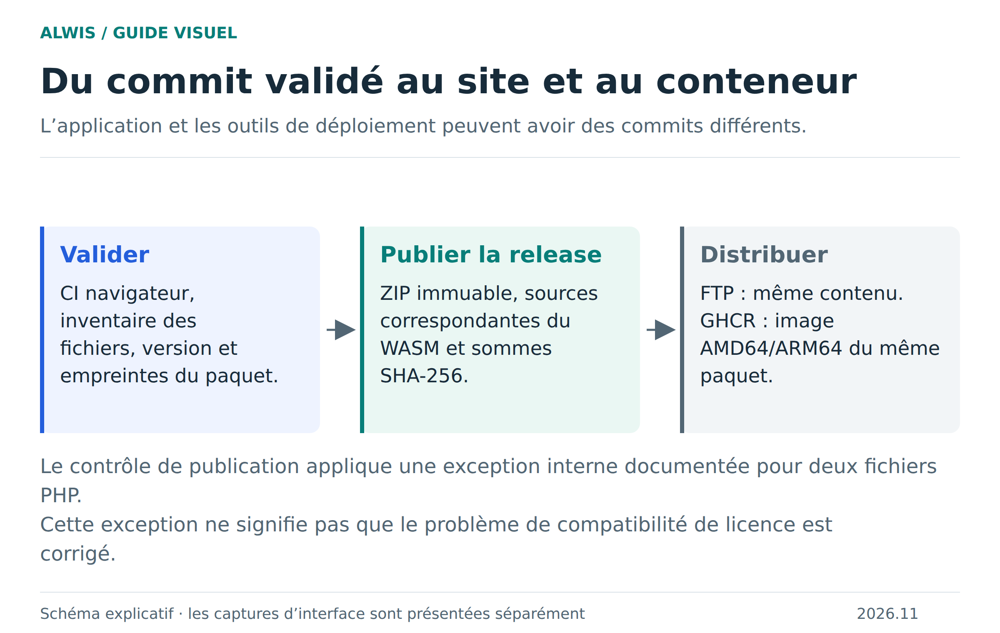

# Édition serveur ALWIS

[Voir le paquet sur GitHub](https://github.com/Bastian-Noel/ALWIS/pkgs/container/alwis-server) · [Configurer et lancer avec Docker Compose](deployment.md)

L’édition serveur distribue la même interface ALWIS derrière un conteneur Node.js et ajoute `/admin/server` pour configurer l’instance. Le tag `latest` suit la dernière publication du conteneur ; les tags numérotés permettent de rester sur une version précise.

Le conteneur ne lance pas PHP ni MariaDB : ces moteurs, ainsi que les projets et leurs fichiers, restent dans le navigateur. SQLite conserve uniquement les réglages de l’instance. Le serveur inclut des fonctions de collaboration WebSocket, activables dans sa configuration. Le navigateur hôte conserve le moteur PHP/MariaDB. Voir [collaboration](collaboration.md) pour les possibilités et limites.

Les paramètres Compose, variables d’environnement, secret administrateur, reverse proxy, mises à jour et sauvegarde sont regroupés dans le [guide Hébergement et publication](deployment.md).


## Configurer l’aperçu des invités

Le mode se règle avec deux variables d’environnement. Il n’y a plus de permission « Aperçu HTTP » dans la fenêtre de partage.

```dotenv
ALWIS_BASE_URL=https://studio.exemple.fr
ALWIS_PREVIEW_MODE=interactive
ALWIS_PREVIEW_URL=https://preview.exemple.fr
```

`ALWIS_PREVIEW_MODE=static` est le défaut : les invités reçoivent un miroir sans scripts de la page de l’hôte, avec son défilement et les requêtes du panneau Réseau. `interactive` exécute les pages et leur JavaScript chez l’invité ; PHP et MariaDB restent chez l’hôte.

`ALWIS_PREVIEW_URL` peut être un domaine distinct ou un sous-domaine du studio. Les deux noms rejoignent le **même port du conteneur**, avec DNS, TLS et conservation du Host et du protocole par le reverse proxy. L’hôte d’aperçu ne sert que les ressources du broker ; il n’expose ni studio, ni administration, ni signalisation. Un sous-domaine sépare le DOM et les stockages, mais des cookies explicitement partagés avec `Domain=.exemple.fr` restent communs.

Si `ALWIS_PREVIEW_URL` est vide ou identique au studio en mode interactif, chaque invité doit accepter une confirmation de confiance. Le JavaScript du projet peut alors accéder à son studio et à son stockage local : cette confirmation ne constitue pas une isolation. Un refus ou un échec conserve le miroir statique. Le Service Worker invité utilise un périmètre propre au canal ; il ne remplace pas celui du studio.

Les nouveaux noms sont `ALWIS_BASE_URL`, `ALWIS_PREVIEW_MODE`, `ALWIS_PREVIEW_URL` et `ALWIS_TRUST_PROXY`. Les anciens `PUBLIC_BASE_URL`, `ALWIS_GUEST_PREVIEW_STATIC`, `ALWIS_PREVIEW_ORIGIN` et `TRUST_PROXY` restent des alias de compatibilité ; les nouveaux noms ont priorité. Le mot de passe `ALWIS_ADMIN_PASSWORD` est obligatoire, sans longueur minimale imposée.

### Connexion directe et relais

ALWIS tente d’abord WebRTC. Le badge **P2P** de chaque participant indique un canal de données réellement ouvert. Si la connexion prend du temps, le relais serveur prend le relais après 3,5 secondes ; la tentative P2P peut encore aboutir jusqu’à 15 secondes. En cas d’échec, le badge **Relais serveur** indique le repli et le panneau affiche le budget partagé de la salle et la taille maximale d’un message.

Le relais conserve les trames en attente d’accusé de réception et réessaie celles refusées pour dépassement du budget. Le serveur reconnaît les renvois par leur référence pour éviter une double livraison. Les limites du relais ne s’appliquent pas aux échanges sur le canal P2P.

## État de validation et version disponible

Le parcours de deux vrais invités, les sessions privées et la base partagée ont été validés dans Chromium et Firefox sur le runtime indépendant. Cette preuve sur runner ne remplace pas la vérification DNS/TLS de votre propre instance. [Preuves et limites](runtime-parity.md).

L’image publique `ghcr.io/bastian-noel/alwis-server:2026.11.0-beta.1` est disponible pour **linux/amd64 et linux/arm64**. `latest` suit la publication courante ; figez un tag numéroté si vous voulez maîtriser vos mises à jour. Publier cette image ne met pas à jour automatiquement un conteneur déjà lancé.



[Schéma SVG](figures/publication.svg) · [Installation Compose](deployment.md) · [Dépannage](troubleshooting.md).
