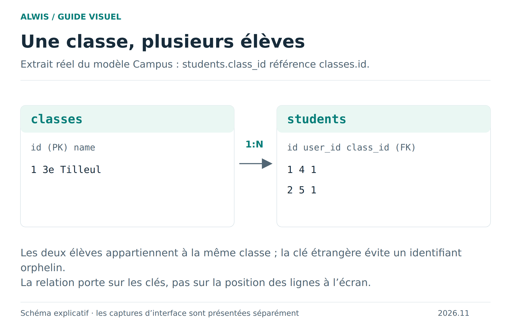
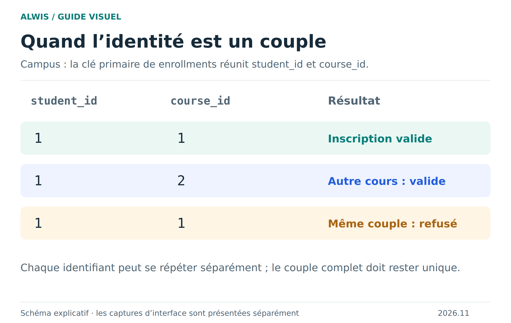

# Relations, clés et identités

Une application évite de recopier partout les mêmes informations. Dans le Campus, le nom de la classe est stocké dans `classes`, tandis que chaque élève conserve une référence `class_id`. Comprendre cette séparation rend les requêtes et les erreurs de contrainte plus faciles à expliquer.

## Une clé identifie une ligne

Une clé primaire permet de retrouver une ligne sans ambiguïté. Ce n’est pas sa position visuelle dans la grille : trier les élèves ne change pas leurs identifiants. Une clé unique empêche aussi les doublons, mais les règles de nullabilité dépendent de sa définition.

[Version SVG](figures/relations.svg)

Dans les données initiales du Campus, la classe d’identifiant `1` est « 3e Tilleul ». Les élèves `1` et `2` la référencent. Leurs `user_id` sont respectivement `4` et `5` : l’identifiant de l’élève n’est pas celui de son compte utilisateur.

Une clé étrangère vérifie qu’une référence existe. Elle empêche par exemple d’affecter un élève à une classe inexistante. Si la colonne accepte `NULL`, une absence de référence peut être autorisée : l’élève Sami n’a pas de responsable renseigné dans les données initiales. Une absence n’est pas une référence vers l’identifiant zéro.

## Une clé peut associer plusieurs colonnes

[Version SVG](figures/cle-composee.svg)

`enrollments` identifie une inscription avec la paire `(student_id, course_id)`. L’élève `1` peut être inscrit aux cours `1` et `2`, mais la paire `(1,1)` ne peut apparaître deux fois. Rendre seulement `student_id` unique interdirait plusieurs cours par élève ; ce serait une autre règle métier.

De la même façon, `grades` utilise `(assignment_id, student_id)` pour identifier la note d’un élève à un devoir. Quand vous modifiez une ligne, conservez l’ensemble de son identité : ne filtrez pas uniquement sur un des deux identifiants.

## Préparer une relation dans le studio

1. Regardez les types des colonnes source et cible : les types et attributs pertinents, notamment le caractère signé des entiers, doivent être compatibles.
2. Vérifiez que la colonne référencée possède l’index requis et que l’ordre des colonnes est correct pour une clé composée.
3. Cherchez les références orphelines déjà présentes. Une contrainte ne peut pas rendre cohérentes des données qui la contredisent.
4. Choisissez l’action de suppression selon le sens métier, puis vérifiez le résultat dans Structure et Schéma.

Le dessin est une aide à la lecture ; MariaDB applique les contraintes. Une requête `JOIN` peut réunir deux tables même sans clé étrangère, mais elle n’empêche pas les futures références invalides.

## Que doit provoquer une suppression ?

**Refuser** protège les éléments encore utilisés : supprimer une classe occupée oblige d’abord à décider du sort de ses élèves. **CASCADE** supprime automatiquement les lignes dépendantes : pratique pour certains détails, dangereux si leur conservation est importante. **SET NULL** retire le lien tout en gardant la ligne dépendante, à condition que la colonne accepte `NULL`.

Il n’existe pas une bonne option universelle. Écrivez d’abord la phrase métier : « si je supprime ce cours, que doivent devenir ses inscriptions et ses notes ? » Puis traduisez cette décision en contraintes et testez sur une copie.

## Exercice de lecture

Dans le Campus, partez de `students`, retrouvez son utilisateur et sa classe, puis cherchez les inscriptions de cet élève. Expliquez pourquoi le nom n’est pas stocké dans `students` et pourquoi deux inscriptions au même cours seraient un doublon.

[Écrire une jointure](sql-workflows.md) · [Comprendre les valeurs](sql-values.md) · [Protéger plusieurs écritures](sql-transactions.md)
