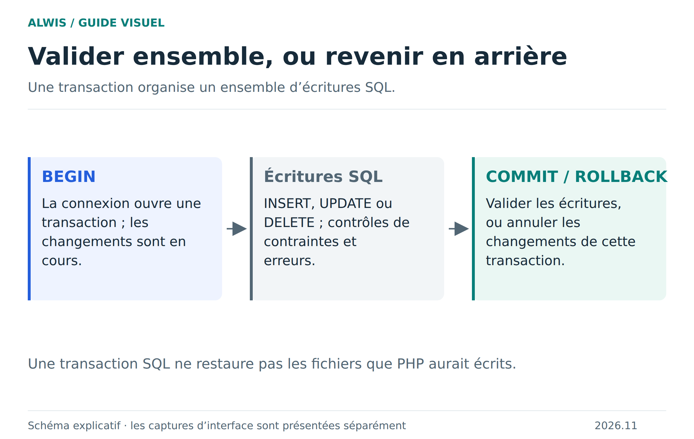

# Transactions : réussir ensemble ou annuler ensemble

Une action métier peut écrire plusieurs lignes : enregistrer une inscription puis un événement, ou modifier plusieurs notes. Une transaction regroupe des opérations SQL pour éviter de conserver seulement la première moitié si la suite échoue.



[Version SVG](figures/transaction.svg)

## BEGIN, COMMIT et ROLLBACK

`BEGIN` ouvre la transaction. `COMMIT` valide ses changements. `ROLLBACK` les annule tant qu’ils n’ont pas été validés. Cet exemple se teste sur une base de démonstration avec InnoDB :

```sql
CREATE TABLE transaction_demo (
  id INT PRIMARY KEY,
  libelle VARCHAR(100) NOT NULL
) ENGINE=InnoDB;

BEGIN;
INSERT INTO transaction_demo VALUES (1, 'Première écriture');
INSERT INTO transaction_demo VALUES (1, 'Doublon volontaire');
ROLLBACK;
SELECT * FROM transaction_demo;
```

La seconde insertion échoue sur la clé primaire. Après le `ROLLBACK`, la première insertion ne doit pas subsister. Utilisez une table neuve ou vérifiez son état initial : des lignes déjà validées auparavant ne sont pas effacées par l’annulation de la nouvelle transaction.

## En PHP, annuler aussi quand une exception arrive

```php
$pdo->setAttribute(PDO::ATTR_ERRMODE, PDO::ERRMODE_EXCEPTION);
try {
    $pdo->beginTransaction();
    $q = $pdo->prepare('INSERT INTO transaction_demo VALUES (?, ?)');
    $q->execute([2, 'Une opération']);
    $q->execute([2, 'Doublon volontaire']);
    $pdo->commit();
} catch (Throwable $error) {
    if ($pdo->inTransaction()) {
        $pdo->rollBack();
    }
    // Journaliser le détail ; présenter un message adapté au visiteur.
    throw $error;
}
```

La table doit déjà exister. Les opérations de définition comme `CREATE TABLE` peuvent provoquer des validations implicites : ne considérez pas une migration de structure comme une série d’écritures ordinaires annulable en bloc. Les garanties dépendent aussi du moteur des tables concernées.

## Trois validations différentes

| Action | Ce qu’elle valide | Ce qu’elle ne remplace pas |
|---|---|---|
| `COMMIT` SQL | Les changements de la transaction dans la base courante | Le point de reprise du projet ALWIS |
| **Enregistrer** dans ALWIS | Une sauvegarde locale des fichiers et bases du projet | Une copie indépendante du navigateur |
| **Exporter ZIP** | Une archive transportable des fichiers et bases | Une sauvegarde automatique sur un autre support |

Une transaction ne rembobine pas les écritures PHP dans les fichiers, un appel HTTP ou un message déjà envoyé. Si votre action combine ces effets, concevez explicitement son ordre et sa récupération.

## Erreurs et requête suivante

ALWIS teste la récupération après des erreurs PHP fatales et des transactions abandonnées. Cela aide à rendre le runtime utilisable pour la requête suivante, mais ne transforme pas toute exécution PHP en opération atomique. Les [détails de récupération](php-error-recovery.md) précisent ce qui est vérifié.

Les points de sauvegarde SQL (`SAVEPOINT`) permettent d’annuler une partie d’une transaction, sans valider le reste. Ils servent à des traitements avancés ; commencez par une transaction courte et un chemin d’erreur clair.

[Bien sauvegarder](saving-projects.md) · [Valeurs SQL](sql-values.md) · [Relations](sql-relations.md)
