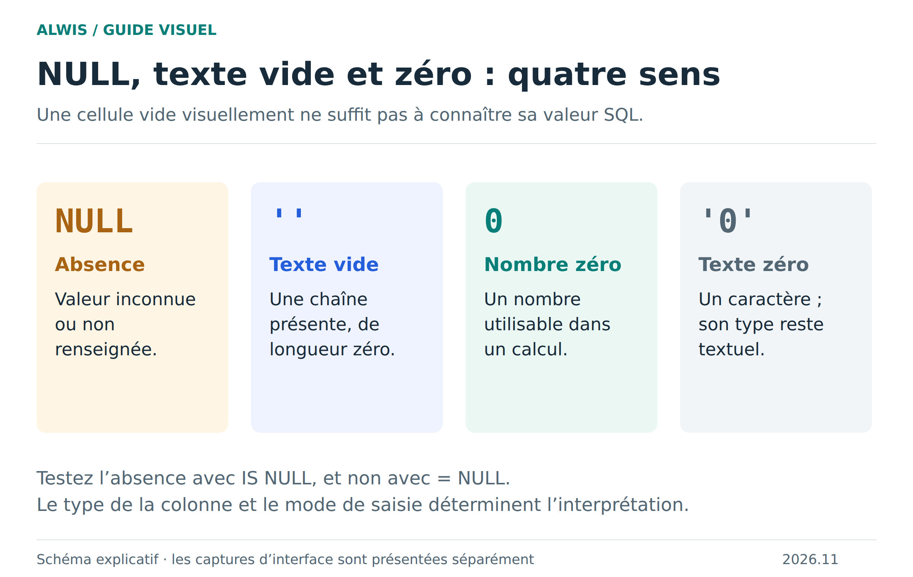
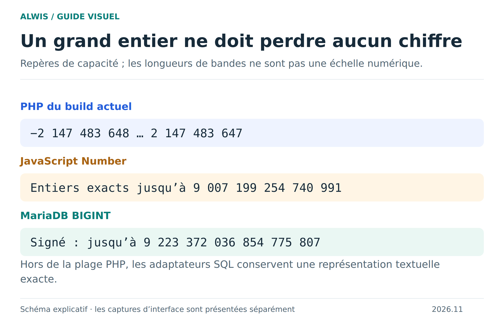
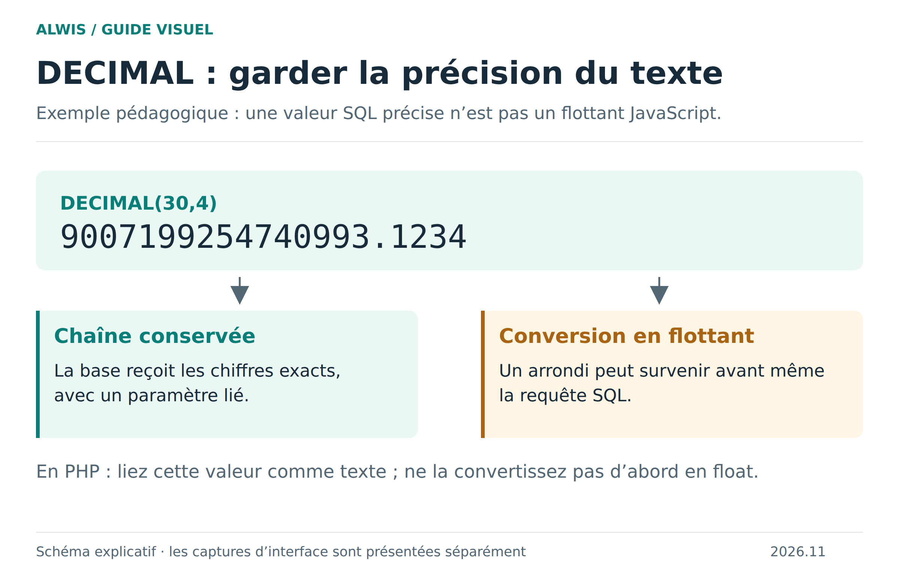
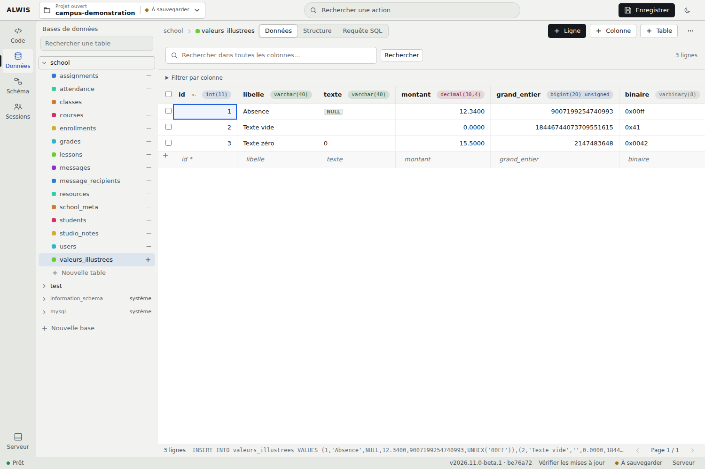

# Comprendre les valeurs SQL, sans perdre d’information

Une grille ne montre pas seulement des textes : chaque valeur a un type, une précision et parfois une absence explicite. Cette page explique comment lire une cellule, choisir un type et transporter un nombre entre MariaDB, PHP et JavaScript sans le déformer.

## NULL, texte vide et zéro



[Version SVG](figures/valeurs.svg)

| Valeur | Ce qu’elle signifie | Exemple concret |
|---|---|---|
| `NULL` | Une absence ou une information inconnue | Une note qui n’a pas encore été saisie |
| `''` | Une chaîne présente de longueur zéro | Un commentaire volontairement vide |
| `0` | Le nombre zéro | Une note effectivement égale à zéro |
| `'0'` | Le caractère zéro dans une chaîne | Un code textuel |

Le type de la colonne détermine ce que MariaDB stocke. Écrire `'0'` dans une colonne numérique peut provoquer une conversion ; les guillemets d’une requête ne suffisent donc pas à garantir un stockage textuel. Pour conserver un code, choisissez une colonne textuelle adaptée.

```sql
SELECT * FROM grades WHERE score IS NULL;
SELECT * FROM grades WHERE score = 0;
SELECT * FROM grades WHERE comment = '';
```

Ces trois filtres répondent à trois questions différentes. `NULL = NULL` ne se comporte pas comme une égalité ordinaire ; utilisez `IS NULL` ou `IS NOT NULL`. Les agrégats comme `AVG(score)` ignorent les valeurs `NULL`, alors qu’un zéro participe au calcul. Remplacer toutes les notes absentes par zéro change donc la moyenne et le sens des données.

**Nullabilité et valeur par défaut sont distinctes.** `NOT NULL` interdit l’absence SQL. `DEFAULT ''` fournit un texte vide quand l’insertion omet la colonne. Une valeur par défaut n’est pas une explication de ce que la personne a réellement saisi.

## Un identifiant très grand doit rester exact



[Version SVG](figures/entiers.svg)

Le PHP du build actuel utilise des entiers signés sur **32 bits**, de −2 147 483 648 à 2 147 483 647. MariaDB peut conserver des entiers bien plus grands dans un `BIGINT`. Les adaptateurs SQL conservent une représentation textuelle exacte lorsque la valeur dépasse la plage entière PHP.

JavaScript ajoute une autre limite : `Number` ne représente exactement tous les entiers que jusqu’à **9 007 199 254 740 991**. L’identifiant `9007199254740993` peut devenir `9007199254740992` si vous le convertissez en `Number`. Il n’a alors plus la même identité.

Conservez les grands identifiants sous forme de chaînes lors des échanges JSON et des traitements qui n’exigent pas un calcul. En PHP, liez une chaîne à un paramètre préparé sans la convertir au préalable en entier :

```php
$id = '9007199254740993';
$query = $pdo->prepare('SELECT id FROM exemple WHERE id = :id');
$query->bindValue(':id', $id, PDO::PARAM_STR);
$query->execute();
```

Cet exemple suppose une table `exemple` possédant la colonne adaptée. `BIGINT UNSIGNED` peut aller jusqu’à 18 446 744 073 709 551 615 ; ce n’est ni un entier PHP 32 bits ni un `Number` JavaScript exact.

## DECIMAL : la précision fait partie de la donnée



[Version SVG](figures/decimal.svg)

`DECIMAL(p,s)` réserve **p chiffres au total**, dont **s après la virgule**. `DECIMAL(4,2)` laisse donc deux chiffres avant le séparateur décimal. Dans le Campus, c’est le type de `grades.score`. Il ne signifie pas à lui seul « note comprise entre 0 et 20 » : cette règle métier demande une validation ou une contrainte supplémentaire.

Pour un exemple indépendant, `DECIMAL(30,4)` peut conserver `9007199254740993.1234`. Garder cette valeur sous forme de chaîne jusqu’à son paramètre SQL évite un arrondi préalable dans JavaScript ou PHP. Une conversion en flottant peut perdre des chiffres avant même l’arrivée dans MariaDB.

Pour un calcul exact, utilisez des opérations SQL décimales ou un outil de calcul décimal adapté. Ajouter des zéros à l’affichage ne répare pas une précision déjà perdue. Vérifiez aussi le mode SQL et les avertissements si une entrée dépasse la précision ou l’échelle de la colonne.

## Texte et binaire : afficher ne suffit pas

Un champ binaire peut contenir les octets `00 FF`, soit **deux octets**. Leur représentation hexadécimale `00FF` comporte quatre caractères : ce n’est pas la longueur du contenu. Un octet nul ne signifie pas `NULL`, et une suite d’octets n’est pas forcément un texte UTF-8 valide.

Pour un texte, l’encodage et la collation influencent la comparaison et le tri. `VARCHAR(100)` décrit une capacité en caractères ; les octets occupés peuvent varier avec l’encodage. Pour des données binaires, examinez la longueur et une représentation hexadécimale plutôt que d’attendre un rendu lisible.



Cette capture utilise une table pédagogique créée pour la documentation ; elle n’est pas une table du Campus d’origine.

## Vérifier une valeur en quatre étapes

1. **Structure :** relevez le type exact, la nullabilité et la valeur par défaut.
2. **Entrée :** distinguez champ omis, texte vide, zéro et absence SQL.
3. **Transport :** contrôlez les conversions PHP/JavaScript et le type du paramètre préparé.
4. **Relecture :** relisez la valeur depuis SQL ; comparez tous les chiffres ou les octets, pas seulement un affichage arrondi.

[Retour au guide SQL](sql-workflows.md) · [Clés et relations](sql-relations.md) · [Transactions](sql-transactions.md)
