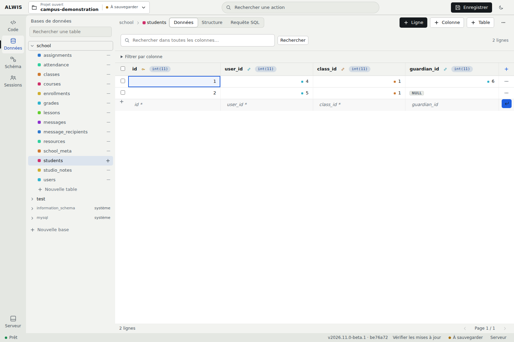
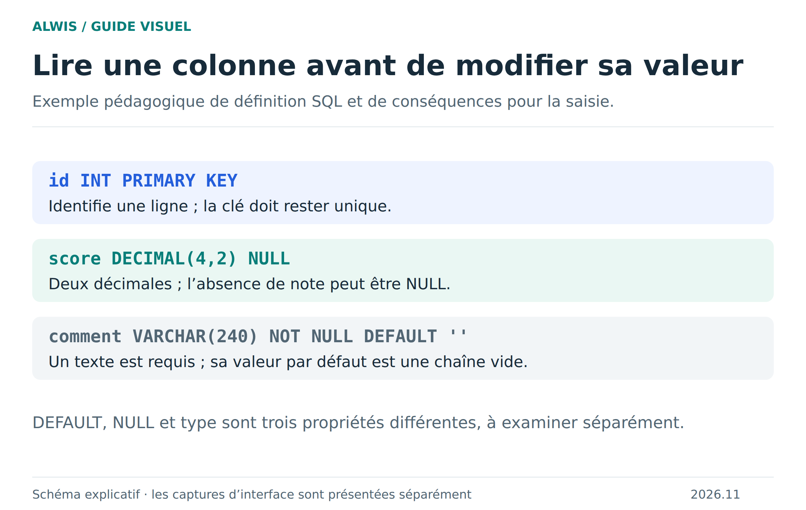
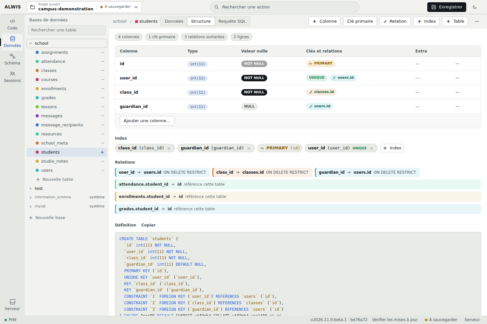

# Explorer les bases, les tables et les requêtes

La vue Données vous permet de regarder le contenu d’une base sans écrire une page PHP pour chaque vérification. Utilisez-la pour comprendre ce que votre application stocke, puis passez à SQL quand vous voulez relier, filtrer ou calculer.



## Trois vues, trois questions

**Données : que contient la table ?** Chaque ligne est un enregistrement. Les cellules montrent les valeurs de ses colonnes. Le nom d’une colonne ne garantit ni son type ni sa signification : `class_id` est un identifiant, pas le nom de la classe.

**Structure : quelles valeurs sont autorisées ?** Lisez le type, la nullabilité, la valeur par défaut et les clés. Une cellule refusée peut révéler une contrainte utile : clé unique déjà présente, référence inexistante ou texte trop long.

**Schéma : comment les tables se relient-elles ?** Les liens suivent les clés étrangères. Une jointure SQL permet ensuite de réunir des informations dispersées entre plusieurs tables.



[Schéma SVG](figures/structure.svg)

## Première requête : des élèves avec des noms

Dans le Campus, `students.user_id` référence `users.id`, et `students.class_id` référence `classes.id`. Cette requête affiche l’élève et sa classe sans recopier les noms dans `students` :

```sql
SELECT s.id, u.name, c.name AS classe
FROM students AS s
JOIN users AS u ON u.id = s.user_id
JOIN classes AS c ON c.id = s.class_id
ORDER BY u.name;
```

Une jointure ne crée pas de lien dans la structure : elle utilise une condition pour lire les lignes ensemble. Une clé étrangère, elle, protège la cohérence des écritures. Les deux ont des rôles complémentaires.

## Lire les valeurs avant de les modifier

Une note non renseignée n’est pas forcément zéro. Dans le Campus, `grades.score` accepte `NULL`. Pour retrouver ces notes :

```sql
SELECT assignment_id, student_id, score
FROM grades
WHERE score IS NULL;
```

`= NULL` ne remplace pas `IS NULL`. Un texte vide, zéro et une absence SQL demandent des tests distincts. Les [types et valeurs](sql-values.md) détaillent ces cas, les grands entiers et les nombres décimaux.



## Écrire avec une intention précise

Commencez par un `SELECT` qui retrouve les lignes visées. Une fois le filtre vérifié, utilisez la même condition pour votre `UPDATE` ou `DELETE`. Sans `WHERE`, l’opération peut toucher toute la table. Exportez une copie avant des changements importants ; une transaction permet d’annuler certaines opérations tant qu’elle n’a pas été validée.

Pour PHP, le runtime expose PDO et MySQLi vers MariaDB embarqué. Dans les exemples locaux, la connexion PDO utilise `mysql:dbname=school;charset=utf8mb4`, l’utilisateur `root` et un mot de passe vide. Ce sont les paramètres du moteur embarqué de démonstration, pas des identifiants à reprendre pour une base publique.

## Approfondir

[Valeurs et types](sql-values.md) · [Relations et clés](sql-relations.md) · [Transactions](sql-transactions.md) · [Sauvegarder les bases](saving-projects.md) · [Exemple Campus](school-example.md)
