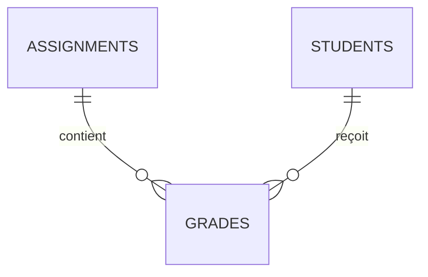

# Bases de données, SQL et relations

[Accueil Wiki](https://github.com/Bastian-Noel/ALWIS/wiki) · [Premiers pas illustrés](README.md) · [Exemple Campus](school-example.md)

Dans ALWIS, **Données** sert à parcourir les lignes et la structure. **Schéma** sert à visualiser et créer les relations. **Requête SQL** exécute le SQL sur la même base que le projet PHP.

## Parcourir et modifier une table

1. Ouvrez **Données** et développez la base à gauche.
2. Choisissez une table pour voir sa grille.
3. Recherchez ou filtrez les lignes ; double-cliquez sur une cellule modifiable pour la changer.
4. Passez à **Structure** pour consulter les colonnes et en ajouter ou modifier.


## Écrire une requête

Ouvrez **Requête SQL**, tapez une requête puis exécutez-la. Essayez par exemple avec le Campus :

```sql
SELECT students.id, users.name
FROM students
JOIN users ON users.id = students.user_id
ORDER BY users.name
LIMIT 20;
```

Les projets qui n’utilisent pas SQL ne démarrent pas MariaDB avant le premier accès SQL. PDO, MySQLi et l’éditeur SQL accèdent à la base du projet.

## Voir et créer une relation

1. Ouvrez **Schéma** pour voir les tables et leurs clés.
2. Choisissez **Relier des tables** (ou **Données → Structure → Relation**).
3. Sélectionnez les clés référencées et les colonnes correspondantes.
4. Pour une clé composée, sélectionnez l’ensemble des colonnes ; choisissez ensuite le comportement de modification et de suppression.


Exemple du Campus : les notes relient une activité à un élève. Une clé composée empêche de créer deux notes pour le même couple :



[Essayer les notes, les inscriptions et les relations dans le Campus](school-example.md) · [Consulter les raccourcis et corrections SQL](ide-workflows.md)
