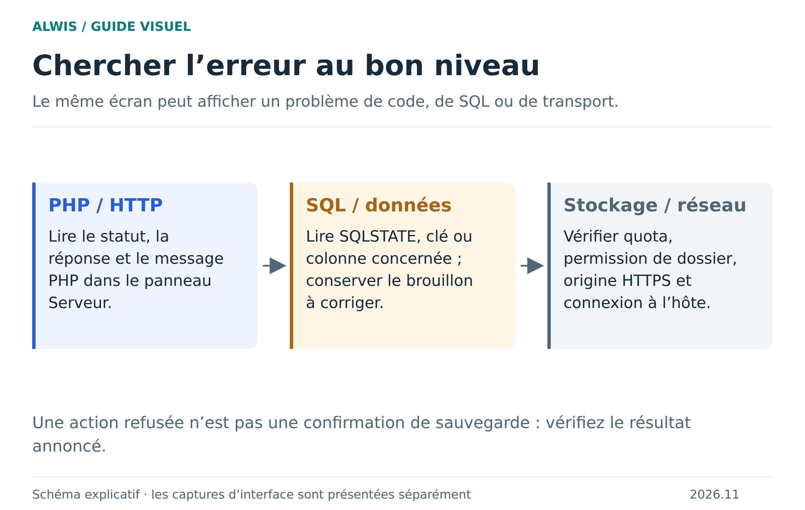

# Dépanner ALWIS, étape par étape

Commencez par relever l’action exacte, la version affichée et le premier message d’erreur. Une page vide, une contrainte SQL et un problème de quota n’appellent pas la même correction. Avant une manipulation de stockage, conservez une archive si le projet s’ouvre encore.

[Version SVG](figures/diagnostic.svg)

## L’aperçu ne s’ouvre pas

Vérifiez que le studio est servi en HTTP local ou en HTTPS, pas par une URL `file://`. Contrôlez le chargement du runtime et l’enregistrement du Service Worker dans les outils du navigateur. Sur un hébergement personnel, vérifiez les en-têtes nécessaires et les types MIME. Reproduisez avec le Campus pour distinguer un problème d’installation d’un problème de projet.

Si le Campus fonctionne, vérifiez le chemin du fichier, les redirections et les erreurs PHP du projet. Un statut 500 décrit une erreur côté exécution ; il ne signifie pas automatiquement que la base est perdue.

## Une erreur PHP bloque une page

Relevez le message et la ligne. Corrigez l’erreur, puis envoyez une nouvelle requête simple. ALWIS teste la reprise après exception non capturée, erreur de syntaxe, sortie non nulle et dépassement de mémoire. Si le runtime est déclaré non réutilisable, il doit être redémarré : insister dans le même moteur ne répare pas son état.

Une reprise réussie ne garantit pas l’annulation de tous les effets de la page précédente. Contrôlez les fichiers écrits et les données validées. [Cycle PHP et récupération](php-error-recovery.md).

## Une cellule ou une requête est refusée

Lisez le message SQL puis la structure. Une clé dupliquée demande de retrouver la ligne existante ; une référence inexistante demande de choisir une clé valide ; un refus de `NULL` demande de distinguer absence et texte vide. N’enlevez pas une contrainte simplement pour faire disparaître le message.

Si un grand identifiant change de derniers chiffres, cherchez une conversion en entier PHP ou en `Number` JavaScript. Relisez la valeur comme une chaîne exacte. [Types et valeurs](sql-values.md) · [Relations](sql-relations.md).

## L’enregistrement ou l’import échoue

Regardez le quota disponible, le volume et le nombre d’entrées. Un dossier contenant énormément de petits fichiers peut atteindre une limite même s’il occupe peu d’octets. Une archive ZIP64 ou une arborescence trop profonde peut être refusée. Ne videz pas le stockage du site avant d’avoir récupéré vos données : cela peut supprimer les projets.

Un dossier du PC demande une permission du navigateur ; si cette permission n’est plus valide, réautorisez le dossier ou utilisez un export ZIP. [Budgets détaillés](storage-opfs.md) · [Sauvegardes](saving-projects.md).

## Un invité voit une image mais ne peut pas interagir

Vérifiez d’abord les droits accordés par l’hôte, puis l’origine d’aperçu dédiée, son DNS, son certificat TLS et la connexion HTTPS/WSS. Une instance sans origine dédiée ne fournit pas l’aperçu HTTP interactif. Un hôte déconnecté ne peut plus exécuter les requêtes des invités. [Guide de collaboration](collaboration.md).

## Un appel HTTP PHP échoue

Essayez l’URL avec les restrictions du navigateur en tête : CORS, HTTPS et redirections. Vérifiez les limites de volume et de délai. Un appel PHP dynamique vers le même runtime est refusé pour éviter un blocage. Ne cherchez pas à corriger ce refus en augmentant indéfiniment un timeout. [Compatibilité HTTP et cURL](http-compatibility.md).

## Préparer un signalement utile

Indiquez le navigateur, la version ALWIS, les étapes minimales, le résultat attendu et le résultat observé. Joignez un petit projet fictif reproductible si possible. Retirez les secrets, données personnelles et cookies des captures ou journaux. [Ouvrir une issue](https://github.com/Bastian-Noel/ALWIS/issues).
