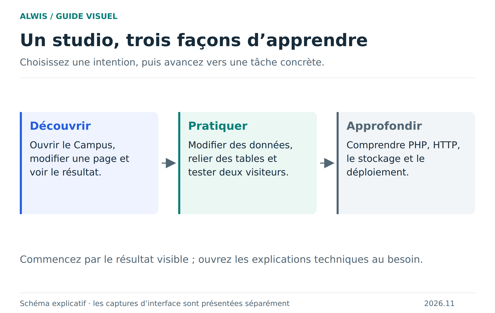

# Bienvenue dans ALWIS

**Apprenez en construisant : du code PHP à la page web, des lignes SQL au modèle de données.**

[Ouvrir le studio](https://studio.mmi.place/) · [Télécharger la bêta](https://github.com/Bastian-Noel/ALWIS/releases/tag/v2026.11.0-beta.1) · [Installation locale](installation.md)

## Découvrir : voir une application fonctionner

Vous découvrez ALWIS ? Suivez ce parcours dans l’ordre. Vous arriverez à un premier changement visible, puis à une sauvegarde réutilisable.

1. [Comprendre le studio, le projet et le visiteur](concepts.md).
2. [Faire vos premiers pas illustrés](README.md).
3. [Explorer le Campus et ses exercices](school-example.md).
4. [Enregistrer et exporter sans confusion](saving-projects.md).

[Version SVG du parcours](figures/parcours.svg)

## Pratiquer : choisir une tâche

| Je veux… | Le guide à ouvrir | Ce que je saurai faire |
|---|---|---|
| Ouvrir mon propre projet | [Projets, ZIP et dossiers](project-workflows.md) | Distinguer import, dossier du PC et projet du navigateur |
| Écrire et tester du code | [Éditeur et aperçu](ide-workflows.md) | Retrouver un fichier, travailler au clavier, relancer une page |
| Voir mes données | [Bases et requêtes SQL](sql-workflows.md) | Lire les tables et réaliser une première jointure |
| Comprendre une cellule | [Types et valeurs](sql-values.md) | Distinguer absence, texte, entier exact et décimal |
| Relier mes tables | [Clés et relations](sql-relations.md) | Choisir les références et expliquer une clé composée |
| Protéger plusieurs écritures | [Transactions](sql-transactions.md) | Valider ensemble ou annuler des changements SQL |
| Tester plusieurs utilisateurs | [Collaboration](collaboration.md) | Séparer visiteurs locaux et invités distants |
| Résoudre un problème | [Dépannage](troubleshooting.md) | Identifier le niveau qui échoue avant d’agir |

## Approfondir : suivre la chaîne technique

Pour comprendre le système, commencez par [l’architecture](architecture.md), puis suivez la [requête HTTP](http-runtime.md) jusqu’au runtime. Consultez ensuite le [stockage et ses budgets](storage-opfs.md), les [erreurs PHP et leur récupération](php-error-recovery.md), la [compatibilité HTTP/cURL](http-compatibility.md) et les [preuves de parité](runtime-parity.md).

La [mémoire en bref](performance-summary.md) explique comment lire les mesures ; le [rapport complet](performance.md) conserve les résultats historiques et leur protocole. La [compilation du WASM](native-qa-build.md) décrit le travail des développeurs.

## Héberger, publier ou contribuer

[Serveur Docker : rôle et installation](server-deployment.md) · [Publication et configuration Compose](deployment.md) · [Contribuer](../CONTRIBUTING.md) · [Versionnement](versioning.md) · [Publication de ce wiki](wiki-publication.md).

Le studio en ligne permet l’essai immédiat. La collaboration HTTP distante demande une configuration serveur et une origine HTTPS dédiée. Consultez la [compatibilité](compatibility.md) avant d’y importer une application existante.

Les limites et l’exception de licence de la bêta sont détaillées dans le [README du dépôt](../README.md). Les captures montrent le produit publié ; les schémas expliquent son fonctionnement. [Illustrations et sources](illustrations.md).
