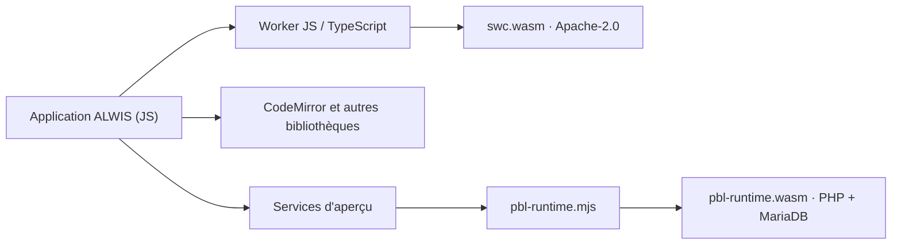

# Séparation technique : éditeur Apache-2.0 et runtime MariaDB GPLv2

**Revue des frontières de build, 10 novembre 2026.** Cette revue constate la séparation des binaires ; elle n’est pas une décision juridique définitive sur tous les échanges exécutés dans le navigateur.

## Ce qui est réellement assemblé

| Ensemble | Entrée de compilation | Sortie chargée dans le navigateur | Relation au runtime GPL |
| --- | --- | --- | --- |
| TypeScript et SWC | `apps/studio/editor/javascript-worker.mjs` et `scripts/build-editor.mjs` | `javascript-worker.mjs`, `swc.wasm` | Worker JavaScript dédié à l'analyse/formatage ; pas de liaison native MariaDB |
| Autres modules éditeur | `apps/studio/editor/codemirror.mjs`, `formatter-worker.mjs`, `lsp-worker.mjs` | Divers modules JS et WASM sous `apps/studio/editor/dist/` | Fichiers séparés à licences propres |
| PHP et MariaDB | `engine/native/build/runtime-target.cmake` | `engine/pbl-runtime.mjs` et `engine/pbl-runtime.wasm` | Une œuvre native combinée : ses obligations GPLv2 restent applicables |

Le processus de compilation Emscripten de `pbl-runtime` ne prend pas comme entrées les modules TypeScript/SWC. La compilation éditeur par esbuild ne produit pas `pbl-runtime.wasm`. Le paquet web les livre sous des chemins distincts et conserve le `THIRD-PARTY.txt` de l'éditeur.

Les licences Apache-2.0 de TypeScript/SWC **n'ont pas automatiquement à être remplacées par GPLv2 parce que les fichiers sont téléchargés depuis le même serveur**. La FSF distingue l'agrégation et la combinaison en fonction du lien technique et de la nature des échanges ; une revue juridique peut être nécessaire en cas de communication intime entre composants. Référence : [FAQ officielle FSF « mere aggregation »](https://www.gnu.org/licenses/gpl-faq.en.html#MereAggregation).

**Décision technique :** pas de copie ni de liaison de TypeScript/SWC dans le binaire MariaDB recensée dans les recettes de build. Cette observation délimite le risque Apache/GPL aux éventuelles combinaisons à analyser, pas à la simple livraison des assets du studio.

**Contrôle de non-régression :** `scripts/verify-editor-boundary.py` vérifie les dépendances de la cible native, les imports de l'éditeur et les fichiers séparés dans le paquet. Une évolution future du build doit refaire cette revue. Cette preuve ne remplace pas l'audit des dépendances réellement liées à MariaDB.
